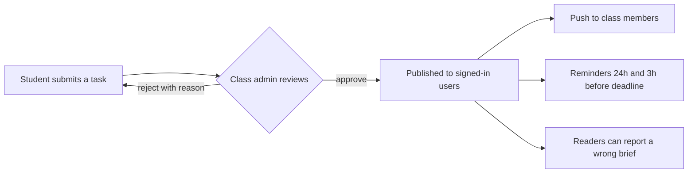

# StarsTask

**One place for every class task, session, and attendance record, so nothing lives in a paper stack or a buried WhatsApp chat again.**

StarsTask is a collaborative academic platform for Indonesian campuses. Students and class admins share assignments, schedule class sessions, and record attendance, with explicit roles instead of group-chat chaos. Deadlines, sessions, and reminders follow Asia/Jakarta time.

> **Status: pre-pilot.** Every feature listed below is implemented in code and covered by unit tests, type checks, and a production build. The database, Google sign-in, push delivery, and cron scheduling have **not yet been verified end to end** against a live project. See [Project Status](#project-status).

## Table of Contents

- [The Problem](#the-problem)
- [What StarsTask Does Differently](#what-starstask-does-differently)
- [How It Works](#how-it-works)
- [Roles at a Glance](#roles-at-a-glance)
- [Features](#features)
- [Tech Stack](#tech-stack)
- [Project Structure](#project-structure)
- [Quick Start](#quick-start)
- [Available Scripts](#available-scripts)
- [Authentication Setup](#authentication-setup)
- [Push Notifications and PWA](#push-notifications-and-pwa)
- [Discussion Sessions, Check-in, and Google Calendar](#discussion-sessions-check-in-and-google-calendar)
- [Security](#security)
- [Documentation](#documentation)
- [Deployment](#deployment)
- [Project Status](#project-status)
- [Roadmap](#roadmap)
- [Contributing](#contributing)
- [License](#license)

## The Problem

Most university classes still run on tools that were never built for the job.

**Attendance is still a paper ritual.** Every meeting, one sheet of paper travels the room, signatures get smudged, and by the end of the semester nobody trusts the numbers. Lose the sheet, or the one person who kept it, and the record is gone.

**Tasks live in WhatsApp, and drown there.** The class group is also where memes, food photos, and hundreds of unread messages live. A lecturer posts "Tugas 3, deadline Jumat" at 9 PM; by morning it is 40 messages deep. Students scroll through screenshots to find which file, which format, which deadline.

**Finding out about a new task depends on luck.** There is no notification that a task exists, only whoever happened to open the group that day. The result is familiar to every student: the deadline you learned about two days late.

## What StarsTask Does Differently

| The old way                                | The StarsTask way                                                                                                                                                                                                                    |
| ------------------------------------------ | ------------------------------------------------------------------------------------------------------------------------------------------------------------------------------------------------------------------------------------ |
| Attendance sheets passed around the room   | **Digital check-in per session.** Students check in from their phone, verified by GPS within a class-defined radius. The organizer can also mark attendance manually, and every override is audited.                                 |
| Task details scattered across chat threads | **One structured assignment per class.** Title, description, files, deadline, and review status in one place, searchable and filterable.                                                                                             |
| "Wait, there was a task?"                  | **Push notification to every class member who opted in** when a task is published, plus optional reminders 24 hours and 3 hours before the deadline.                                                                                 |
| Deadline tracked by memory                 | **Live deadline badges and a personal week view.** The dashboard shows what is due today, this week, and what already slipped.                                                                                                       |
| WhatsApp groups with no roles              | **Explicit roles.** Class admins review and publish submissions, students contribute, platform admins moderate. Every sensitive action is written to an audit log.                                                                   |
| A wrong brief stays wrong                  | **Reader reports and revision history.** Readers flag a wrong deadline or a broken file; reviewers fix it through the normal edit path, and every change to a published brief is recorded automatically.                             |
| Absence letters handed over informally     | **Absence requests with evidence.** Students record dates and a supporting document; the class admin checks it and downloads a package for the lecturer. StarsTask never approves an absence, that decision stays with the lecturer. |

## How It Works



A class admin's own posts are published directly after their attachments upload, because a reviewer can never review their own work. Content is visible only to signed-in users; anonymous visitors see the landing page and the public class directory.

## Roles at a Glance

| Role                        | How it is granted                                       | What it can do                                                                                  |
| --------------------------- | ------------------------------------------------------- | ----------------------------------------------------------------------------------------------- |
| Visitor                     | No account                                              | Landing page, public class directory                                                            |
| Member (student)            | Sign in with Google, then join a class                  | Read published tasks, submit tasks, RSVP, check in, file absence requests                       |
| Class admin (_ketua kelas_) | Approved class application, or verified representative  | Review and moderate their own class, run sessions, forward absence packages, manage invitations |
| Platform admin              | Seeded manually in the database; no UI or API grants it | Approve classes, verify representatives, moderate across classes                                |
| Developer                   | Email allowlist (`DEVELOPER_EMAILS`)                    | Internal monitoring console; no student-facing access                                           |

There is no lecturer account. Roles are never read from the browser: identity comes from the verified server session and is re-checked inside the database. Full permission tables are in [docs/CLASSES.md](./docs/CLASSES.md).

## Features

### Assignments and review

| Area                  | Description                                                                                                                                                                                                      |
| --------------------- | ---------------------------------------------------------------------------------------------------------------------------------------------------------------------------------------------------------------- |
| Assignment management | Submit, edit, and delete your own assignments; attach up to three files.                                                                                                                                         |
| Two content types     | Every class post is either a **lecturer assignment** (instructions a class admin recorded; the source lecturer may be named) or a **class announcement**. The type is a checked database column, not a UI label. |
| Personal completion   | Students tick off assignments for their own tracking. Stored per student and per assignment, invisible to class admins and lecturers, and never a submission.                                                    |
| Google Drive links    | Optional Drive or Docs link per assignment, validated to a Google host and opened in a new tab.                                                                                                                  |
| Search and filters    | Filter by course, semester, type, tag, and deadline; full-text search.                                                                                                                                           |
| Assignment review     | Class admins approve or reject; approval publishes the assignment.                                                                                                                                               |
| Public moderation     | Unpublish, archive, restore, and remove sensitive attachments.                                                                                                                                                   |
| Reader reports        | Flag a wrong deadline, wrong details, a duplicate, or a broken file. Reports are advisory.                                                                                                                       |
| Revision history      | Every change to a published brief is recorded by a database trigger and cannot be rewritten.                                                                                                                     |
| Saved assignments     | Follow an assignment you do not own to receive its reminders.                                                                                                                                                    |
| Personal dashboard    | Deadline badges, a seven-day "My Week" view, and a banner for overdue tasks.                                                                                                                                     |

### Classes and access

| Area                   | Description                                                                                         |
| ---------------------- | --------------------------------------------------------------------------------------------------- |
| Authentication         | Sign in with Google through Supabase Auth.                                                          |
| Profile onboarding     | Nickname, student ID, and class. Legal name and student ID stay private.                            |
| Classes and roles      | Approved classes, separate class and platform admin scopes.                                         |
| Class applications     | Any signed-in user may apply; a platform admin approves or rejects.                                 |
| Invitations            | Hashed, expiring, usage-limited, optionally email-restricted links.                                 |
| Join by class name     | Classes that opt in let a student join by typing the class name; invitation-only is the default.    |
| Class rep verification | A declared position plus evidence; a platform admin approval grants class admin for that one class. |

### Sessions, attendance, and calendar

| Area                     | Description                                                                                                     |
| ------------------------ | --------------------------------------------------------------------------------------------------------------- |
| Discussion sessions      | Class admins schedule tutorials and reviews with RSVP and capacity.                                             |
| Attendance check-in      | GPS-verified within a class-defined radius, or marked manually by the organizer.                                |
| Shared academic calendar | One `/schedule` view of deadlines, sessions, the weekly timetable, exams, academic events, and personal events. |
| Add to Google Calendar   | One link, no account needed; never exposes participant data.                                                    |
| Calendar sync            | Optional OAuth connection that copies sessions into your own calendar.                                          |

### Notifications and PWA

| Area                   | Description                                                                                   |
| ---------------------- | --------------------------------------------------------------------------------------------- |
| In-app inbox           | Every event is stored and readable at `/notifications`, with unread state and per-item read.  |
| Instant publish alerts | Web Push to every class member when a task is published (once per revision, author excluded). |
| Deadline reminders     | Opt-in Web Push reminders 24 hours and 3 hours before a deadline.                             |
| Session reminders      | Opt-in Web Push 24 hours and 3 hours before a session you are going to.                       |
| PWA                    | Installable manifest and a push-only service worker.                                          |

### Administration

| Area                    | Description                                                                                  |
| ----------------------- | -------------------------------------------------------------------------------------------- |
| Absence requests        | Students record dates and evidence; class admins forward, never approve.                     |
| OCR document extraction | Optional reader suggests dates from a PDF text layer; the student confirms each one.         |
| CSV / PDF exports       | Summary PDF, complete PDF with evidence, ZIP, and injection-safe CSV.                        |
| Platform admin console  | Review applications and verifications, moderate content, read the audit trail.               |
| Developer monitoring    | Internal, allowlisted `/developer` view of accounts, sign-ins, activity, errors, and health. |
| Access control          | Server-side authorization plus RLS and private storage.                                      |

> These tables reflect the code in this repository. Planned items are intentionally not described as working features.

## Tech Stack

| Technology                                    | Purpose                                                    |
| --------------------------------------------- | ---------------------------------------------------------- |
| [Next.js](https://nextjs.org/) (App Router)   | Web application and routing                                |
| [TypeScript](https://www.typescriptlang.org/) | Type safety                                                |
| [Tailwind CSS](https://tailwindcss.com/)      | Styling and responsive UI                                  |
| [Supabase](https://supabase.com/)             | Authentication, PostgreSQL database, RLS, and file storage |
| [Zod](https://zod.dev/)                       | One set of validation schemas shared by client and server  |
| [Vercel](https://vercel.com/)                 | Application deployment and cron scheduling                 |
| Web Push (VAPID)                              | Reminders and publish alerts through `web-push`            |
| Google OAuth                                  | User authentication and optional calendar sync             |
| pnpm                                          | Package management (monorepo workspaces)                   |
| Vitest / Playwright                           | Unit, integration, and browser tests                       |

## Project Structure

```text
apps/web/              Next.js application (App Router)
  src/app/             Routes: (home) (site) (onboarding) (workspace) (console) api
  src/components/      UI components grouped by domain
  src/features/        Multi-step workflows: uploads, RSVP, calendar sync, leave
  src/lib/             Data access, Supabase clients, security, storage, push, OCR
  tests/               unit, integration, and e2e suites
packages/contracts/    Zod schemas and constants shared by client and server
packages/shared/       Pure helpers: deadlines, ICS, CSV, calendar, formatting
supabase/migrations/   Versioned SQL: schema, RLS, functions, storage policies
docs/                  Runbooks and design notes
scripts/               Environment check, icon and salt generators
```

Layering rule: UI renders, `lib/db` is the only place that queries Supabase, `features` orchestrates multi-step operations, and the database is the final write boundary through `SECURITY DEFINER` functions. Details are in [docs/ARCHITECTURE.md](./docs/ARCHITECTURE.md).

## Quick Start

### Prerequisites

- Node.js 20.9 or newer, in a version compatible with the project's Next.js release
- [pnpm](https://pnpm.io/)
- A Supabase project (or the [Supabase CLI](https://supabase.com/docs/guides/cli) for a local instance)
- A Google OAuth client configured for Supabase Auth

### Install and run

```bash
git clone <repository-url>
cd starstask
pnpm install
cp .env.example apps/web/.env.local   # PowerShell: Copy-Item .env.example apps/web/.env.local
# fill in the values, then:
pnpm check:env
pnpm db:reset                          # local Supabase: applies every migration
pnpm dev
```

Open [http://localhost:3000](http://localhost:3000). Without Supabase configured the app still builds and shows a setup notice instead of failing.

### Environment variables

Values prefixed with `NEXT_PUBLIC_` reach the browser and must be safe to publish. Everything else is server-only. The template in [.env.example](./.env.example) contains placeholders for every variable.

| Group                  | Variables                                                                                                                   | Rule                                                                                              |
| ---------------------- | --------------------------------------------------------------------------------------------------------------------------- | ------------------------------------------------------------------------------------------------- |
| Core (required)        | `NEXT_PUBLIC_SUPABASE_URL`, `NEXT_PUBLIC_SUPABASE_PUBLISHABLE_KEY`, `NEXT_PUBLIC_SITE_URL`, `RATE_LIMIT_SALT` (32+ chars)   | Required                                                                                          |
| Push and cron          | `VAPID_PUBLIC_KEY`, `VAPID_PRIVATE_KEY`, `VAPID_SUBJECT`, `SUPABASE_SERVICE_ROLE_KEY`, `CRON_SECRET`                        | VAPID all-or-none; the service role may be set alone; cron needs both the service role and secret |
| Google Calendar sync   | `GOOGLE_CALENDAR_CLIENT_ID`, `GOOGLE_CALENDAR_CLIENT_SECRET`, `GOOGLE_CALENDAR_REDIRECT_URI`, `GOOGLE_TOKEN_ENCRYPTION_KEY` | All or none; the "Add to Google Calendar" link works without them                                 |
| Developer console      | `DEVELOPER_EMAILS` (comma-separated allowlist)                                                                              | Empty or malformed means nobody gets access                                                       |
| OCR                    | `OCR_PROVIDER` (`pdf-text` default, or `disabled`)                                                                          | Optional                                                                                          |
| Distributed rate limit | `UPSTASH_REDIS_REST_URL`, `UPSTASH_REDIS_REST_TOKEN`                                                                        | Optional pair; otherwise a Postgres counter is used                                               |
| Tests only             | `SUPABASE_TEST_URL`, `SUPABASE_TEST_ANON_KEY`, `SUPABASE_TEST_SERVICE_ROLE_KEY`                                             | Never set these in a deployment                                                                   |

`scripts/check-env.mjs` fails when a group is partially configured, when the encryption key is not 32 bytes, or when a secret is exposed through a `NEXT_PUBLIC_` variable.

> **Warning:** never commit `.env.local`, and never expose service-role keys, OAuth client secrets, or VAPID private keys in client-side code. The service-role key is server-only and is used just by code that must bypass RLS, such as the cron scheduler.

## Available Scripts

The exact scripts are defined in `package.json`.

| Command                             | Description                                                                                                |
| ----------------------------------- | ---------------------------------------------------------------------------------------------------------- |
| `pnpm dev`                          | Start the development server                                                                               |
| `pnpm build`                        | Create a production build                                                                                  |
| `pnpm start`                        | Serve the production build                                                                                 |
| `pnpm lint`                         | Run ESLint across the workspace                                                                            |
| `pnpm typecheck`                    | Run TypeScript type checking                                                                               |
| `pnpm test`                         | Run unit tests                                                                                             |
| `pnpm test:integration`             | Run the opt-in RLS suite (needs `SUPABASE_TEST_*`; CI runs it on a disposable local Supabase)              |
| `pnpm test:e2e`                     | Run Playwright browser tests (the authenticated flows skip unless `E2E_SUPABASE_*` point at a local stack) |
| `pnpm format` / `pnpm format:check` | Apply / verify Prettier formatting                                                                         |
| `pnpm check:env`                    | Validate environment variables before deploying                                                            |
| `pnpm db:push`                      | Apply migrations to the linked Supabase project                                                            |
| `pnpm db:reset`                     | Reset a local Supabase instance                                                                            |
| `pnpm db:types`                     | Regenerate `apps/web/src/types/database.generated.ts`                                                      |

The PWA icons in `apps/web/public/icons` are exported from the brand logo at
`apps/web/public/brand/logo.png`: 192, 512, maskable 512, 180 Apple touch, and the
96 px notification badge. Re-export them when the logo changes.

The authenticated Playwright flows sign disposable users in against a local Supabase
stack. They are skipped unless `E2E_SUPABASE_URL`, `E2E_SUPABASE_ANON_KEY`, and
`E2E_SUPABASE_SERVICE_ROLE_KEY` are set and both the stack and `PLAYWRIGHT_BASE_URL`
are loopback. They create and delete rows, so never point them at the hosted project.

## Authentication Setup

StarsTask uses Google authentication through Supabase Auth.

1. Create or open a Supabase project.
2. Enable Google as an authentication provider.
3. Add the Google OAuth client credentials in Supabase.
4. Register the Supabase callback URL in the Google Cloud Console.
5. Configure the application's allowed redirect URLs in Supabase (include the `**` wildcard after `/auth/callback`).
6. Add the required environment variables locally and in the deployment environment.

The Google OAuth callback URL uses this format:

```text
https://<project-ref>.supabase.co/auth/v1/callback
```

Use your own Supabase project reference, and do not reuse credentials from another environment. The first platform admin must be seeded manually; see [docs/CLASSES.md](./docs/CLASSES.md#14-manual-setup).

## Push Notifications and PWA

StarsTask is installable and can send reminders and publish alerts through the browser.

- Users opt in from `/settings/notifications`; the browser permission prompt is shown only after a click.
- When a class admin publishes a task, every member who opted in receives a notification, sent once per revision. The payload carries no assignment content, only a generic message and a link.
- Reminders are sent about 24 hours and 3 hours before a deadline for assignments the user owns or saved.
- On iPhone and iPad (iOS/iPadOS 16.4+), the site must be added to the Home Screen first. The settings page explains this and does not show a non-working enable button in Safari.
- The service worker at `/sw.js` only shows notifications and opens the target page. It has no `fetch` handler and caches nothing, so authenticated pages are never served stale.

The scheduler is a set of cron routes protected by `CRON_SECRET`. They are not active until a cron source is configured. On Vercel Hobby the 10-minute schedule requires Pro; see [docs/PUSH_NOTIFICATIONS.md](./docs/PUSH_NOTIFICATIONS.md) for alternatives and the full runbook.

## Discussion Sessions, Check-in, and Google Calendar

Class admins (_ketua kelas_) schedule discussion sessions (tutorials, review meetings, Q&A), and members RSVP with `going`, `maybe`, or `not_going`. Platform admins and class admins are the only roles that can create or edit sessions; students participate but never schedule. Capacity is enforced inside the database with a row lock, so two people cannot take the last seat.

**Attendance check-in replaces the paper sheet.** An in-person session can define a check-in point (latitude, longitude, radius in meters). Members check in from their phones; the database function re-validates membership, session state, check-in window, and distance on every attempt, so the UI is never the security boundary. The organizer can also record attendance manually, including for members who could not use geolocation, and every override is audited. Check-in is evidence of proximity, not proof: browser coordinates can be spoofed, so treat a suspicious record as a conversation, not an automatic sanction.

Every session offers **"Add to Google Calendar"**: a plain link that opens Google with the title, time, location, and join link pre-filled. It needs no account connection and no calendar permission, and it deliberately contains no participant information. Cancelled sessions render no link at all.

Optionally, a user can connect their own Google Calendar from `/settings/calendar`. That uses a separate OAuth client with the single scope `calendar.events`, stores the tokens encrypted on the server, and copies sessions into the user's calendar. StarsTask stays the source of truth: edits flow one way, and deleting the connection deletes the tokens without signing anyone out.

The full runbook (schema, permissions, RSVP rules, check-in rules, OAuth flow, sync behaviour, and troubleshooting) is [docs/SESSIONS.md](./docs/SESSIONS.md).

## Security

Security is part of the foundation, not a later layer:

- Authorization is enforced on the server **and** by database policies; either layer alone would still be correct.
- Row Level Security protects sensitive records, and privileged transitions run in `SECURITY DEFINER` functions that derive the actor from `auth.uid()`.
- Private documents live in non-public storage buckets and are served through short-lived signed URLs (5 minutes for medical and verification evidence, 15 minutes for assignment attachments).
- Uploaded files are validated by extension, size, and file signature; the browser's declared type is ignored.
- Redirect destinations are validated to prevent open-redirect vulnerabilities.
- Secrets and privileged credentials stay out of client-side code.
- Push endpoints and subscription keys are never returned to the browser; only the public VAPID key is exposed.
- Invitation tokens are stored as SHA-256 hashes and never logged. Class admins and platform admins are separate roles that cannot be self-assigned.
- Personal data is minimized: the student ID and legal name have no client-side grant, and notification payloads never contain evidence, names, or document content.
- Cron routes reject requests without a timing-safe bearer-token check.

See [docs/SECURITY.md](./docs/SECURITY.md) for the trust boundaries and the full authorization matrix, [docs/CLASSES.md](./docs/CLASSES.md) for role boundaries, and [docs/ADMIN_CONSOLE.md](./docs/ADMIN_CONSOLE.md) for the platform admin console.

To report a vulnerability, contact the project maintainers privately instead of opening a public issue.

## Documentation

| Document                                               | What it covers                                                  |
| ------------------------------------------------------ | --------------------------------------------------------------- |
| [ARCHITECTURE](./docs/ARCHITECTURE.md)                 | Layers, request flows, caching, design trade-offs               |
| [DATABASE](./docs/DATABASE.md)                         | Schema, migrations, storage                                     |
| [API](./docs/API.md)                                   | HTTP endpoints and error contract                               |
| [SECURITY](./docs/SECURITY.md)                         | Trust boundaries, RLS, validation, residual risks               |
| [AUTHENTICATION](./docs/AUTHENTICATION.md)             | Sign-in flow and redirects                                      |
| [CLASSES](./docs/CLASSES.md)                           | Roles, class workflow, review, moderation                       |
| [SESSIONS](./docs/SESSIONS.md)                         | Sessions, RSVP, check-in, Google Calendar                       |
| [SCHEDULE](./docs/SCHEDULE.md)                         | Shared academic calendar                                        |
| [LEAVE_REQUESTS](./docs/LEAVE_REQUESTS.md)             | Absence requests, evidence, OCR, forwarding, exports            |
| [CLASS_VERIFICATION](./docs/CLASS_VERIFICATION.md)     | Class representative verification                               |
| [TRUST_LOOP](./docs/TRUST_LOOP.md)                     | Reader reports and revision history                             |
| [PROFILE_ONBOARDING](./docs/PROFILE_ONBOARDING.md)     | Profile fields and class auto-matching                          |
| [PUSH_NOTIFICATIONS](./docs/PUSH_NOTIFICATIONS.md)     | Web Push, reminders, scheduler runbook                          |
| [ADMIN_CONSOLE](./docs/ADMIN_CONSOLE.md)               | Platform admin console                                          |
| [DEVELOPER_MONITORING](./docs/DEVELOPER_MONITORING.md) | Internal monitoring console                                     |
| [DEPLOYMENT](./docs/DEPLOYMENT.md)                     | Supabase, Google Cloud, and Vercel runbook                      |
| [PILOT_RUNBOOK](./docs/PILOT_RUNBOOK.md)               | Closed one-class pilot: setup, operations, incidents, exit      |
| [PILOT_MEASUREMENT](./docs/PILOT_MEASUREMENT.md)       | Pilot metrics, evidence ledger, and backlog triage              |
| [PRD](./docs/PRD.md)                                   | The original MVP scope; partly superseded by the class workflow |

## Deployment

StarsTask is designed to run on Vercel with Supabase. **It has not been deployed yet**; the full runbook is [docs/DEPLOYMENT.md](./docs/DEPLOYMENT.md) and push-specific steps are in [docs/PUSH_NOTIFICATIONS.md](./docs/PUSH_NOTIFICATIONS.md).

1. Import the repository into Vercel with **Root Directory** set to `apps/web`.
2. Add the required environment variables for each environment.
3. Add the production domain to the allowed redirect URLs in Supabase Auth.
4. Apply all migrations to the target Supabase project before releasing.
5. Configure a cron source for `/api/cron/deadline-reminders`, `/api/cron/notification-events`, and `/api/cron/session-jobs` if reminders are enabled. Vercel Hobby only supports daily cron; a 10-minute schedule needs Pro or an external scheduler.

## Project Status

StarsTask is under active development. Every feature in [Features](#features) is implemented in code. Reader reports exist for assignment briefs only; account suspension is not implemented.

| Area                                                                          | State                                                                                                |
| ----------------------------------------------------------------------------- | ---------------------------------------------------------------------------------------------------- |
| Type check, lint (zero warnings), unit tests, production build                | Passing locally                                                                                      |
| Playwright tests for public pages, redirects, authenticated flows, WCAG scans | Passing against a disposable local Supabase stack; authenticated specs skip without `E2E_SUPABASE_*` |
| Migrations applied to a real Postgres, RLS and storage policies               | Verified on a fresh local Supabase instance; a CI job runs the same suite                            |
| Google sign-in, uploads, signed URLs                                          | **Not yet verified**                                                                                 |
| Push delivery, iOS Home Screen behaviour, cron schedule                       | **Not yet verified**; no key pair, scheduler, or physical device was used                            |
| Google Calendar API sync                                                      | **Not yet verified**                                                                                 |
| Deployment                                                                    | Not performed                                                                                        |

Known limitations worth knowing before a pilot:

- Notifications are stored in the in-app inbox and delivered through Web Push when enabled; iOS push requires the Home Screen app.
- Student ID and university are self-declared and not verified.
- OCR reads only the text layer of PDFs; scans are accepted but not read.
- Check-in coordinates come from the browser and can be spoofed.
- Pending attachments are readable by every class admin of that class; reviewer assignment is not modelled.
- There is no error-tracking integration and no automatic retention job for evidence or delivery records.

Platform admin access must be seeded manually; see [docs/CLASSES.md](./docs/CLASSES.md).

## Roadmap

Direction, not a commitment:

1. Verify the full stack on a staging project: migrations, RLS tests in CI, OAuth, uploads, push, and a running cron source.
2. Run a closed pilot with a single class and collect feedback.
3. Harden for wider use: account suspension, data retention jobs, error tracking, and refreshed documentation.

## Contributing

Contributions and improvements are welcome.

1. Review the engineering rules in [AGENTS.md](./AGENTS.md). They apply equally to people and AI coding agents.
2. Keep changes focused and consistent with the current scope.
3. Inspect existing patterns before adding code, and reuse them.
4. Run lint, type checking, tests, and the production build; do not claim a check passed unless it ran.
5. Document any required environment or database changes in your pull request.

Code must pass ESLint with zero warnings and be formatted with Prettier. Database changes go in a new, uniquely versioned migration, never in an edited old one.

## License

No license has been specified yet. All rights remain with the respective copyright holder until a license is added to the repository.
