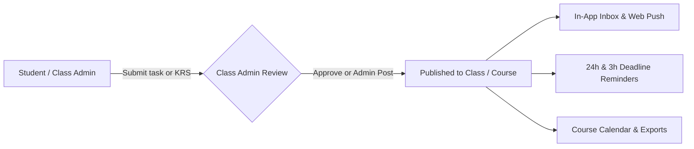

# StarsTask

**One academic workspace for class assignments, course materials, attendance, schedules, leave requests, and encrypted class messaging — built for Indonesian campuses.**

[](https://github.com/knsiuss/starstask/actions/workflows/ci.yml)
[](https://nextjs.org/)
[](https://www.typescriptlang.org/)
[](https://supabase.com/)

StarsTask replaces scattered WhatsApp threads and paper attendance sheets with structured, role-scoped class and course workspaces. Deadlines, meetings, schedules, and reminders follow `Asia/Jakarta` time.

---

## Table of Contents

- [Why StarsTask](#why-starstask)
- [Core Workflows](#core-workflows)
- [Roles and Permissions](#roles-and-permissions)
- [Features](#features)
- [Monorepo Structure](#monorepo-structure)
- [Tech Stack](#tech-stack)
- [Quick Start](#quick-start)
- [Environment Variables](#environment-variables)
- [Available Scripts](#available-scripts)
- [Security Architecture](#security-architecture)
- [Documentation](#documentation)
- [Contributing](#contributing)
- [License](#license)

---

## Why StarsTask

| Everyday friction on campus                             | How StarsTask handles it                                                                                                                                                                           |
| :------------------------------------------------------ | :------------------------------------------------------------------------------------------------------------------------------------------------------------------------------------------------- |
| Paper attendance sheets get lost or forged              | **GPS-verified & audited attendance.** Students check in within the session radius; organizers can manually correct records with physical-verification attestation and an append-only audit trail. |
| Tasks and materials drown in WhatsApp chat              | **Course-scoped workspaces.** Assignments, Pertemuan 1–16 materials, schedules, comments, and grades live inside each course.                                                                      |
| "Wait, when was the deadline?"                          | **Unified calendar & alerts.** Personal week view, `/schedule` timeline, and opt-in Web Push alerts on publish and 24h / 3h before deadlines.                                                      |
| Retake (_mengulang_) students clutter unrelated courses | **Per-course access scope.** Course-scoped invitations (`course_scope = 'selected'`) restrict retake students to only their enrolled courses across UI, exports, and RLS.                          |
| Absence letters sent informally                         | **Structured absence requests.** Students attach evidence (`pdf`/`image`) and dates; class admins forward packages to lecturers (approvals remain with the lecturer).                              |
| Re-typing attendance into campus portals                | **SIAKAD browser extension sync.** Short-lived HMAC sync codes let `apps/extension` transfer meeting rosters directly without exposing user credentials.                                           |

---

## Core Workflows



- **Database as the final trust boundary:** Privileged state transitions run inside `SECURITY DEFINER` PostgreSQL functions deriving the actor from `auth.uid()`, backed by Row Level Security (RLS).
- **Private storage & short-lived links:** Attachments, medical/verification evidence, and async exports are stored privately (Supabase Storage, Backblaze B2, or Cloudflare R2) and served through short-lived signed URLs or 256-bit SHA-256 share tokens.

---

## Roles and Permissions

| Role                            | How it is granted                                                              | Scope                                                                                           |
| :------------------------------ | :----------------------------------------------------------------------------- | :---------------------------------------------------------------------------------------------- |
| **Visitor**                     | Unauthenticated                                                                | Landing page (`/`) and public directory                                                         |
| **Member (Student)**            | Google OAuth via Supabase Auth + class/course invitation or self-join          | Read scoped tasks/materials, submit work, check in, file absence requests, E2EE DM              |
| **Class Admin (_Ketua Kelas_)** | Self-created class, approved application, verified rep, or class manager grant | Manage class/courses, review submissions, run attendance meetings, enter grades, export reports |
| **Lecturer**                    | Verified institutional email domain matching an active university              | Manage their own university-linked classes, BAP, grading, and attendance                        |
| **Platform Admin**              | Seeded manually in `public.platform_admins`                                    | Approve class applications, verify representatives, moderate across classes                     |
| **Developer**                   | Email allowlist (`DEVELOPER_EMAILS`)                                           | Internal `/developer` observability console (error digests, auth activity, health)              |

See [docs/CLASSES.md](./docs/CLASSES.md) and [docs/SECURITY.md](./docs/SECURITY.md) for the complete authorization matrix.

---

## Features

### Courses, Assignments & Materials

- **Course-scoped workspaces:** Organize classes into courses (`class_subjects`) with per-meeting materials (Pertemuan 1–16 in Markdown, sandboxed HTML, or PDF/image files), threaded comments with image attachments, and emoji reactions.
- **Course-scoped invitations & QR codes:** Generate SHA-256 hashed, expiring, usage-limited, optionally email-restricted invite links and QR codes for an entire class or a single course (`course_scope = 'selected'`).
- **Assignment lifecycle & trust loop:** Draft/review queue, personal completion tracking, revision history triggers, reader reports, and Google Drive submission links (`/d/[token]`) with 30-day revocable share tokens.
- **KRS import:** Parse uploaded KRS PDFs or screenshots to provision canonical class identities, courses, and collision-checked weekly schedules.

### Attendance, Grading & Exports

- **GPS check-in & manual corrections:** Geo-fenced check-ins (`geo`), organizer manual overrides (`manual`) requiring reason + physical verification, and `system` / `offline_sync` support with full `attendance_correction_audits`.
- **Inline grading & BAP:** Per-course weighted grading (`Absensi`, `Tugas`, `UTS`, `UAS` summing to 100%) and lecture notes (_Berita Acara Perkuliahan_ / `bap_topic`, `bap_notes`) stored per meeting.
- **Branded Excel, PDF & ZIP exports:** Sync and async (Upstash QStash worker) exports for semester attendance recaps, checklists, meeting sheets, and leave-request evidence packages.
- **SIAKAD sync extension:** Chrome extension (`apps/extension`) consuming short-lived HMAC tokens from `/api/attendance/sync`.

### Communication, Calendar & Clients

- **E2EE Direct & Group Messages:** Multi-device X3DH/ECDH (`v2`) and Group Sender Keys (`v2g`), encrypted media attachments, passphrase key backup, and per-participant privacy/block controls.
- **Unified schedule & Google Calendar:** `/schedule` combines assignment deadlines, weekly timetables, exams, discussion sessions, and personal events with optional one-way Google Calendar OAuth sync.
- **Notifications & PWA:** In-app notification inbox (`/notifications`), Web Push reminders (`web-push` + VAPID), and push-only service worker (`/sw.js`) with no stale-cache risk.
- **Mobile companion:** Capacitor + native Android shell in `apps/mobile`.

---

## Monorepo Structure

```text
apps/
  web/                  Next.js 16 (App Router) web application
    src/app/            Route groups: (home), (site), (onboarding), (workspace), (console), api/
    src/components/     Domain-organized React UI components
    src/features/       Multi-step workflows (attendance, classes, leave, exports, calendar)
    src/lib/            Server DB access, Supabase clients, E2EE crypto, security, storage, push
    tests/              Vitest unit/integration suites and Playwright E2E tests
  mobile/               Capacitor + Android native wrapper
  extension/            SIAKAD attendance sync browser extension
packages/
  contracts/            Shared Zod validation schemas and domain constants
  shared/               Pure utilities (deadlines, calendar ranges, ICS, CSV, formatting)
supabase/
  migrations/           Versioned PostgreSQL schema, RLS policies, triggers, and RPCs
docs/                   Architecture, security, API, database, and operations runbooks
scripts/                Env validation (`check-env.mjs`), DB type generator, and helpers
```

---

## Tech Stack

| Layer                  | Technology                                                           |
| :--------------------- | :------------------------------------------------------------------- |
| **Web Framework**      | Next.js 16.4.6 (App Router, Turbopack), React 19.3, TypeScript 5.9   |
| **Styling & UI**       | Tailwind CSS v4, Radix UI primitives, Lucide icons                   |
| **Database & Auth**    | Supabase (PostgreSQL, Row Level Security, Google OAuth, Storage)     |
| **Validation**         | Zod v4 (`@starstask/contracts`)                                      |
| **Object Storage**     | Supabase Storage, Backblaze B2, Cloudflare R2 (`@aws-sdk/client-s3`) |
| **Background & Cache** | Upstash QStash (async export worker), Upstash Redis (rate limiting)  |
| **Documents & Media**  | ExcelJS, `pdf-lib`, `unpdf`, `jszip`, `qrcode`                       |
| **Notifications**      | Web Push (`web-push` VAPID), Firebase Admin                          |
| **Testing & Quality**  | Vitest, Playwright, Axe-core, ESLint 9 (zero-warning), Prettier      |

---

## Quick Start

### Prerequisites

- **Node.js** `>= 20.9.0`
- **pnpm** `11.x` (`packageManager: pnpm@11.10.0`)
- **Supabase project** (or [Supabase CLI](https://supabase.com/docs/guides/cli) + Docker for local development)
- **Google OAuth** client configured in Supabase Auth (`https://<project-ref>.supabase.co/auth/v1/callback`)

### Install and Run Locally

```bash
git clone https://github.com/knsiuss/starstask.git
cd starstask
pnpm install
cp .env.example apps/web/.env.local   # PowerShell: Copy-Item .env.example apps/web/.env.local
# Fill in required environment variables in apps/web/.env.local
pnpm check:env
pnpm db:reset                          # Local Supabase: applies all migrations
pnpm dev
```

Open [http://localhost:3000](http://localhost:3000).

---

## Environment Variables

Only `NEXT_PUBLIC_*` variables are exposed to the browser; all keys, tokens, and secrets remain strictly server-side. See [.env.example](./.env.example) for the full template.

| Group                   | Variables                                                                                                                 | Notes                                                          |
| :---------------------- | :------------------------------------------------------------------------------------------------------------------------ | :------------------------------------------------------------- |
| **Core (Required)**     | `NEXT_PUBLIC_SUPABASE_URL`, `NEXT_PUBLIC_SUPABASE_PUBLISHABLE_KEY`, `NEXT_PUBLIC_SITE_URL`, `RATE_LIMIT_SALT` (32+ chars) | Required to run                                                |
| **Server & Cron**       | `SUPABASE_SERVICE_ROLE_KEY`, `CRON_SECRET`, `VAPID_PUBLIC_KEY`, `VAPID_PRIVATE_KEY`, `VAPID_SUBJECT`                      | Required for cron jobs, push delivery, and admin storage tasks |
| **Storage (Optional)**  | `B2_*` (Backblaze B2) or `R2_*` (Cloudflare R2)                                                                           | Falls back to Supabase Storage when unset                      |
| **Google Integrations** | `GOOGLE_CALENDAR_CLIENT_*`, `GOOGLE_DRIVE_CLIENT_*`, `GOOGLE_TOKEN_ENCRYPTION_KEY` (32 bytes)                             | Optional OAuth sync & Drive picker                             |
| **Queue & Rate Limit**  | `UPSTASH_QSTASH_*`, `UPSTASH_REDIS_REST_*`                                                                                | Falls back to sync exports / Postgres rate limit when unset    |
| **Observability**       | `DEVELOPER_EMAILS`, `NEXT_PUBLIC_SENTRY_DSN`, `NEXT_PUBLIC_POSTHOG_KEY`                                                   | Optional developer console & telemetry                         |

Run `pnpm check:env` before deploying to verify no partial groups or leaked secrets exist.

---

## Available Scripts

| Command                             | Description                                             |
| :---------------------------------- | :------------------------------------------------------ |
| `pnpm dev`                          | Start Next.js development server (`@starstask/web`)     |
| `pnpm build`                        | Build production bundle (`@starstask/web`)              |
| `pnpm start`                        | Serve production build                                  |
| `pnpm lint`                         | Run ESLint across all workspace packages                |
| `pnpm typecheck`                    | Run `tsc --noEmit` across all workspace packages        |
| `pnpm test`                         | Run Vitest unit suites across all workspace packages    |
| `pnpm test:integration`             | Run opt-in RLS/DB integration tests (`SUPABASE_TEST_*`) |
| `pnpm test:e2e`                     | Run Playwright browser tests                            |
| `pnpm format` / `pnpm format:check` | Format / verify code with Prettier                      |
| `pnpm check:env`                    | Validate environment configuration                      |
| `pnpm db:push`                      | Push local migrations to the linked Supabase project    |
| `pnpm db:reset`                     | Reset local Supabase stack and apply all migrations     |
| `pnpm db:types`                     | Regenerate `apps/web/src/types/database.generated.ts`   |

---

## Security Architecture

- **Defense-in-depth authz:** Every server route and page verifies the authenticated session (`getUser()`) and role, reinforced by PostgreSQL RLS policies and `SECURITY DEFINER` RPCs.
- **Strict CSP & CSRF protection:** Per-request CSP nonces (`script-src 'nonce-...' 'strict-dynamic'`), `Sec-Fetch-Site` / `Origin` checks on state-changing `/api/` routes, and validated internal redirects (`safeRedirectPath`).
- **Upload & SSRF hardening:** Magic-byte file validation, bounded multipart uploads, `import "server-only"` guards, and strict storage allowlists for export branding logos.
- **Privacy & E2EE:** Student IDs (`nim`), legal names, evidence files, and DM ciphertexts are protected by column grants, private buckets, and client-side WebCrypto keys.

To report a security issue, please contact the maintainers privately rather than opening a public issue.

---

## Documentation

| Document                                           | Topic                                                  |
| :------------------------------------------------- | :----------------------------------------------------- |
| [AGENTS.md](./AGENTS.md)                           | Engineering, linting, spacing, and security guidelines |
| [docs/ARCHITECTURE.md](./docs/ARCHITECTURE.md)     | Layering, request flows, and system boundaries         |
| [docs/DATABASE.md](./docs/DATABASE.md)             | Database schema, migrations, and storage buckets       |
| [docs/API.md](./docs/API.md)                       | API routes and response/error contracts                |
| [docs/SECURITY.md](./docs/SECURITY.md)             | Trust boundaries, RLS, and residual risks              |
| [docs/CLASSES.md](./docs/CLASSES.md)               | Class roles, invitations, review, and moderation       |
| [docs/SESSIONS.md](./docs/SESSIONS.md)             | Attendance meetings, GPS check-in, and Calendar sync   |
| [docs/LEAVE_REQUESTS.md](./docs/LEAVE_REQUESTS.md) | Absence requests, OCR, forwarding, and exports         |
| [docs/DEPLOYMENT.md](./docs/DEPLOYMENT.md)         | Supabase, Google Cloud, and Vercel deployment runbook  |

---

## Contributing

1. Read [AGENTS.md](./AGENTS.md) before making changes.
2. Branch off `main` using Conventional Commits (`feat:`, `fix:`, `docs:`, `chore:`).
3. Ensure `pnpm typecheck`, `pnpm lint` (0 errors, 0 warnings), `pnpm format:check`, `pnpm test`, and `pnpm build` pass before opening a PR.
4. Keep database changes in new, timestamped files under `supabase/migrations/`.

---

## License

All rights reserved. No open-source license has been granted yet.
