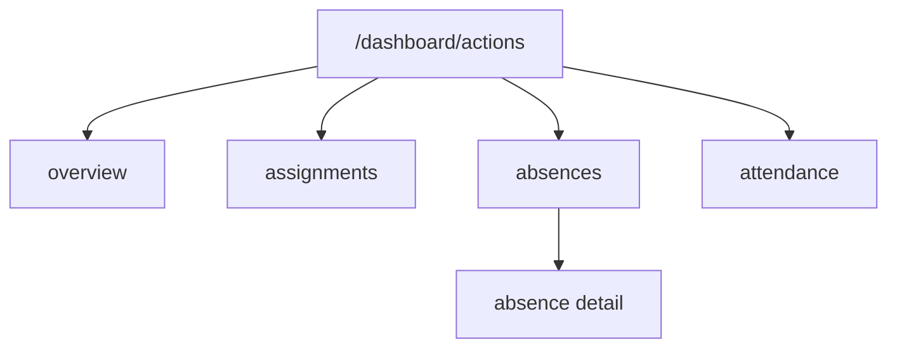
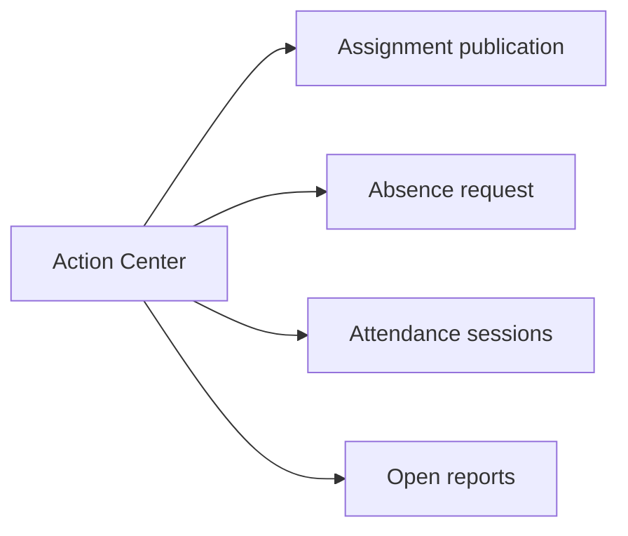
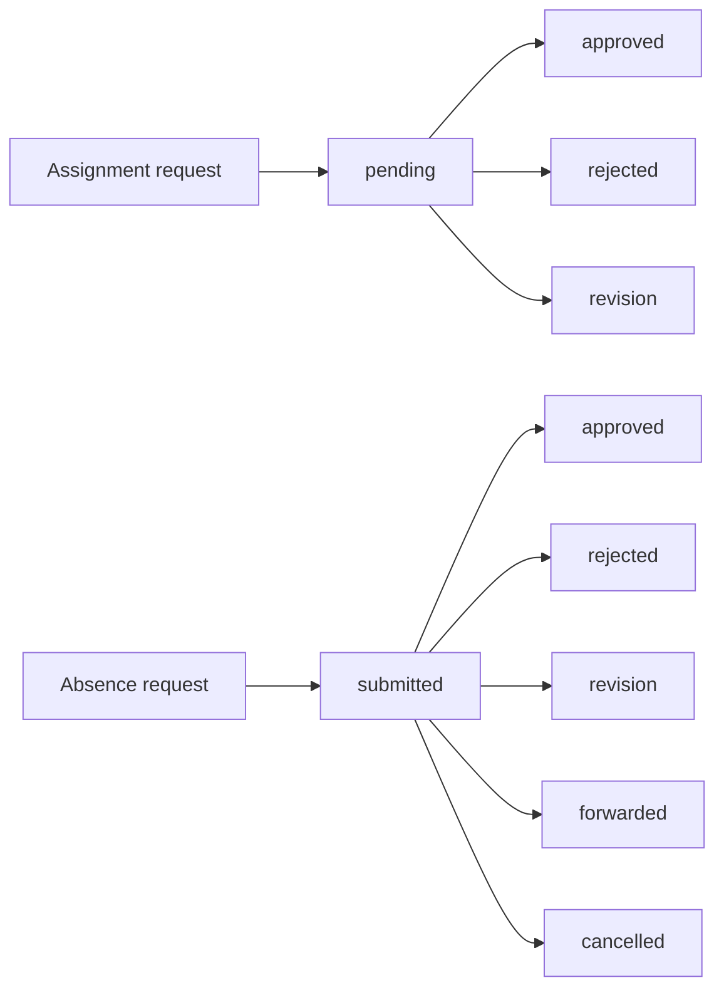
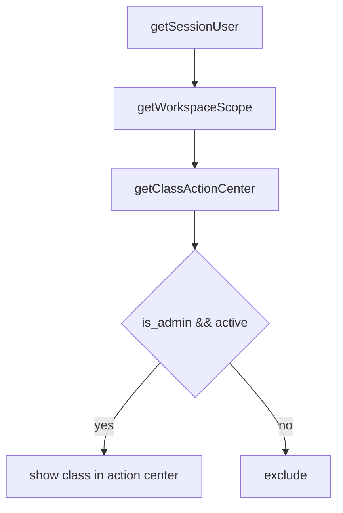
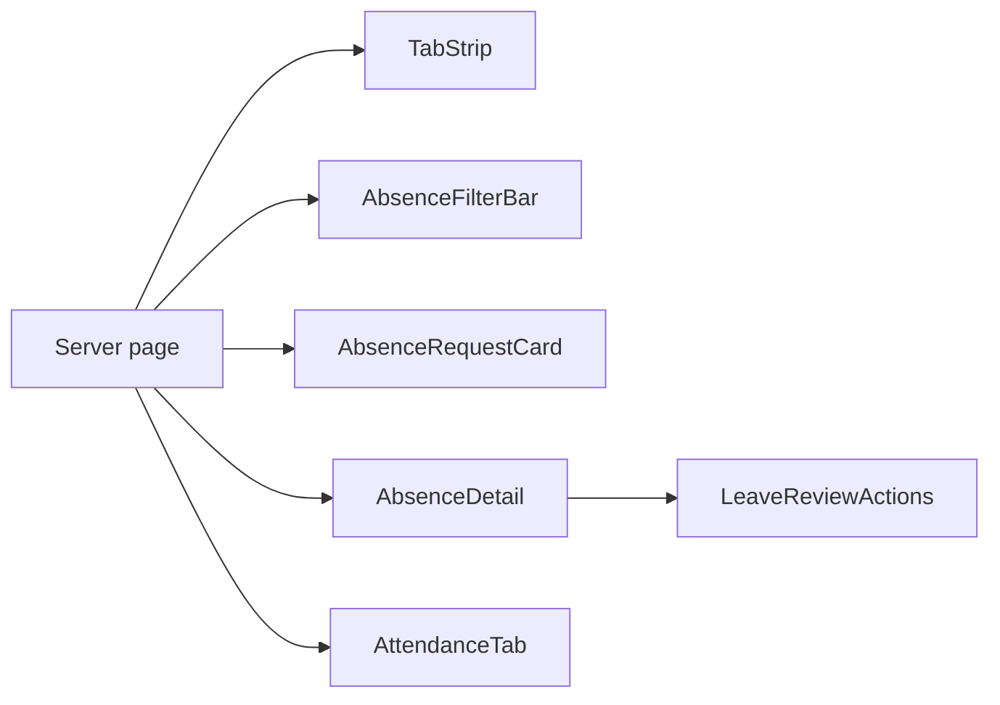

# Action Center Architecture

Last updated: 2026-11-04

## Page hierarchy

## Request categories

## Lifecycles

## Role-based access

## Responsive strategy

- Single server page; tabs rendered from URL params.
- Mobile order via CSS only; no client branching.
- Lists wrap; no table overflow.

## Shared components

## Data fetching

- One server request per tab; independent tabs do not refetch when inactive.
