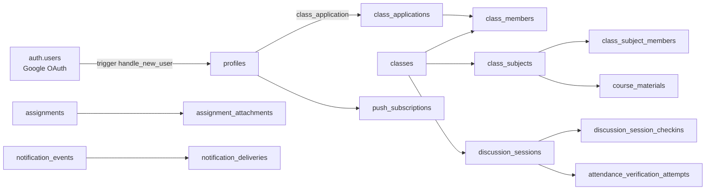

# 02 — Current-State Architecture Baseline

> **Status:** DRAFT. **Method:** each prior claim marked VERIFIED (repo evidence), REPORTED (prior Phase 4A/4B docs, no live DB re-verified), or UNVERIFIED/UNKNOWN. **No live DB access in Phase 4C.**

## 2.1 Claim verification table

| #   | Prior claim                                          | Phase-4C verdict                      | Evidence / note                                                                                                                                                                                                                                                                           |
| --- | ---------------------------------------------------- | ------------------------------------- | ----------------------------------------------------------------------------------------------------------------------------------------------------------------------------------------------------------------------------------------------------------------------------------------- |
| 1   | 52 production tables                                 | **VERIFIED (consistent)**             | 52 entries in `database.generated.ts` Tables section; 52 `CREATE TABLE` accounts found in migrations (case-insensitive).                                                                                                                                                                  |
| 2   | ~3.4 MB data / ~19 MB total                          | **REPORTED**                          | From Phase 4A/4B docs; no live DB access to reproduce. Plausible for pilot scale. LOW confidence — do not use for capacity planning.                                                                                                                                                      |
| 3   | 112 foreign keys                                     | **REPORTED (consistent)**             | Phase 4B §1 histogram sums to 112 FKs (65 CASCADE + 43 SET NULL + 4 RESTRICT = 112). Repo FK `references` occurrences: 153 (includes inline/duplicate mentions) — consistent order of magnitude. Exact catalog count NOT independently reproduced.                                        |
| 4   | 83 RLS policies                                      | **REPORTED**                          | 115 text occurrences of `create policy` (includes DROP+CREATE pairs and storage.objects policies). Distinct public-schema policies ≈ 83 per audits. Not catalog-verified.                                                                                                                 |
| 5   | 159 functions (production) / 143 (generated types)   | **VERIFIED (143 in generated types)** | `awk` count of Functions section = 143. Phase 4B notes production has `rls_auto_enable()` extra → 158–159. Repo text count of function creations: 212 (includes `CREATE OR REPLACE` re-definitions).                                                                                      |
| 6   | 143 SECURITY DEFINER                                 | **INCONSISTENT — flagged**            | Verbatim `security definer` occurrences = **208** across migrations (VERIFIED count). Prior claim "143 SECURITY DEFINER" likely conflates "143 functions total" with "143 SECURITY DEFINER". **Do not cite 143 as SECURITY DEFINER count.** See `24-rls-and-function-security-review.md`. |
| 7   | class_members ~30 rows                               | **REPORTED**                          | Cannot verify without live DB.                                                                                                                                                                                                                                                            |
| 8   | ~23k seq scans                                       | **REPORTED**                          | Live `pg_stat_user_tables` data; no access.                                                                                                                                                                                                                                               |
| 9   | audit_logs ~273 rows                                 | **REPORTED**                          | No access.                                                                                                                                                                                                                                                                                |
| 10  | `is_class_member()` usage                            | **VERIFIED**                          | Defined `20261029001100_class_functions.sql:32` (SQL, STABLE, SECURITY DEFINER, `search_path=''`). Used in RLS + functions across ≥19 migration files + `apps/web/src/lib/db/classes.ts`. See `24-…`.                                                                                     |
| 11  | No university tenant boundary                        | **VERIFIED**                          | No `universities` table; `profiles.university` is free text (`20261029002700`). No tenant columns.                                                                                                                                                                                        |
| 12  | Global uniques (e.g. `courses.normalized_name`, NIM) | **VERIFIED**                          | `courses_normalized_name_key`; `20261029003110_profile_nim_unique.sql` (NIM unique — REPORTED global uniqueness issue).                                                                                                                                                                   |
| 13  | pg_cron absent                                       | **VERIFIED (in migrations)**          | 0 hits for `pg_cron` in migrations. Production installation UNKNOWN but no evidence of use.                                                                                                                                                                                               |
| 14  | API cron used                                        | **VERIFIED**                          | Routes under `apps/web/src/app/api/cron/*` (attendance-retention, deadline-reminders, notification-events, notification-retention, session-jobs).                                                                                                                                         |
| 15  | `rls_auto_enable()` / `ensure_rls` production-only   | **REPORTED (Phase 4B §2)**            | Grep across 83 migrations: no matches (VERIFIED absent locally). Production presence per Phase 4A catalog.                                                                                                                                                                                |

## 2.2 Current architecture summary

## 2.3 Known integrity risks (from repo evidence)

1. **No tenant boundary:** any user can access any class data if RLS predicate passes; no `university_id` isolation (VERIFIED ABSENT).
2. **Global NIM uniqueness may block multi-university students** (REPORTED; `20261029003110`).
3. **SECURITY DEFINER sprawl:** 208 occurrences; predicates like `is_class_member()` are SECURITY DEFINER _by design_ (recursion avoidance — comment in `20261029001100`), but each new definer function widens review surface.
4. **No grading domain** to anchor grade integrity (VERIFIED ABSENT).
5. **API cron without DB scheduler:** retention/reminders depend on external cron caller hitting Next.js routes (VERIFIED present; caller config UNKNOWN/REPORTED).

## 2.4 Storage (VERIFIED)

Buckets: `assignment-attachments` (private, 10 MiB, mime allowlist in `supabase/config.toml`), leave-evidence, verification-evidence (created in respective migrations), class media (`20261102100000`). `storage.objects` policies: read/insert/delete per bucket (assignments + leave + verification VERIFIED; media policy UNKNOWN — needs grep confirmation in Phase 5A).

---

_All size/row/activity statistics remain REPORTED. Phase 5A must reproduce them with live catalog queries before citing them._
