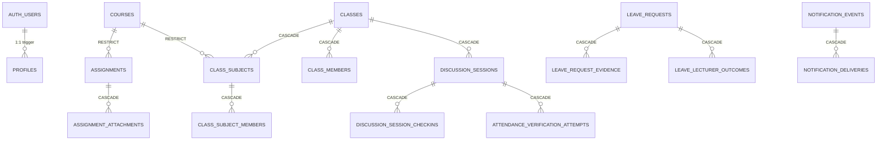
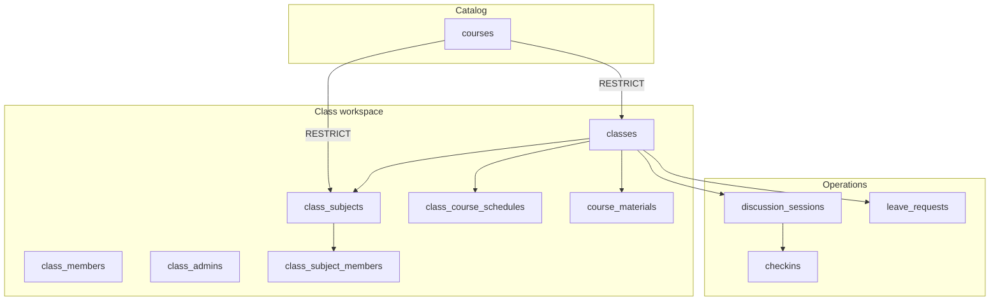

# 04 — Existing Relationship Analysis

> **Status:** DRAFT. **Basis:** FK declarations in migrations. FK action histogram per Phase 4B §1 (REPORTED): CASCADE 65, SET NULL 43, RESTRICT 4, NO ACTION 112 (all ON UPDATE).

## 4.1 FK matrix (abridged, VERIFIED from DDL)

| From (child) | To (parent) | ON DELETE | Notes |
|--------------|-------------|-----------|-------|
| profiles | auth.users | CASCADE | one-to-one |
| assignments.course_id | courses | RESTRICT | catalogue protection |
| assignments.user_id | auth.users | CASCADE | owner |
| assignment_attachments.assignment_id | assignments | CASCADE | |
| class_members (class_id, user_id) | classes, auth.users | CASCADE | junction |
| class_admins (class_id, user_id) | classes, auth.users | CASCADE | junction + flags |
| class_subjects (class_id → classes, course_id → courses) | classes/people | CASCADE / RESTRICT | offering |
| class_subject_members (class_subject_id, user_id) | class_subjects, auth.users | CASCADE | retake enrollment |
| discussion_sessions.class_id | classes | CASCADE | |
| discussion_session_checkins.session_id | discussion_sessions | CASCADE | attendance rows |
| attendance_verification_attempts.session_id | discussion_sessions | CASCADE | |
| leave_requests.{applicant,class_id} | auth.users, classes | CASCADE | |
| leave_request_evidence.leave_request_id | leave_requests | CASCADE | |
| leave_lecturer_outcomes | leave_requests, users, class_subjects | CASCADE | |
| class_invitation_acceptances.invitation_id | class_invitations | CASCADE | |
| notification_deliveries | notification_events, users | CASCADE | |
| google_calendar_event_mappings | connections, sessions | CASCADE | |
| developer_incident_notes.incident_id | developer_incidents | CASCADE | |
| course_materials.class_subject_id | class_subjects | CASCADE | |
| class_course_schedules.class_subject_id | class_subjects | CASCADE | |

SET NULL cases (≈43): nullable FKs such as `lecturer_name`-adjacent references, reminder/mapping back-pointers, moderation references — allow preserving history when a parent is soft-deleted (VERIFIED pattern; exact column list in `DATABASE_RELATIONSHIPS.md` REPORTED).

## 4.2 Dependency description

- `courses` is the strongest root (RESTRICT from assignments/classes) — catalogue must never be casually deleted.
- `classes` is the operational root for members/admins/subjects/sessions/leave.
- `class_subjects` is the bridge between global catalogue (`courses`) and per-class offering; `class_subject_members` breaks the "home class only" assumption (retake support).
- `discussion_sessions` doubles as the attendance-meeting container (trigger fills attendance row on insert — VERIFIED in `20261101090000`); attendance rows hang off sessions, not off `class_subjects` directly (design to review in target model).
- `auth.users` is referenced everywhere; `profiles` is its 1:1 extension.
- `notification_events → notification_deliveries` is the transactional outbox (claim/complete RPCs).

## 4.3 Mermaid (core)

## 4.4 Integrity risks observed

- `class_subject_members` FKs to `class_subjects` but RLS for retake users depends on `is_class_member()` against the *home* class — retake from another class's course needs explicit policy review (see `24-…`).
- Attendance check-ins reference sessions, not subjects — a meeting's course scope is implicit (through session→class, not session→subject). Target model must make course scope explicit (`17-attendance.md`).
- `assignment_attachments.owner_id` rename history (`20261103130000`) suggests ownership semantics shifted; verify current owner predicate before reuse.

---

*Exact 112-row FK table lives in `docs/database/architecture/DATABASE_RELATIONSHIPS.md` (REPORTED); this file is the verified condensed view.*
