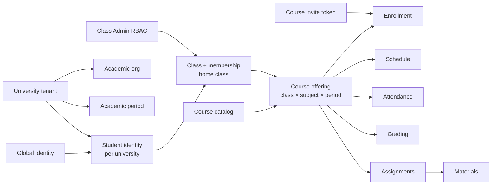

# 06 — Product Domain Model (Domains A–Q)

> **Status:** DRAFT. **Decisions:** brief items marked CONFIRMED; rest RECOMMENDED/PROPOSED/UNRESOLVED.

| Domain | Name | Purpose | Lifecycle | Key entities | Docs |
|--------|------|---------|-----------|--------------|------|
| A | Global identity | One global user account across universities | register → active (no deletion) | `users` (auth), `profiles` | `07-global-identity.md` |
| B | University registry / tenant | Central registry; Platform Admin activates | registered → pending → active → suspended → inactive | `universities` (registry) | `08-…` |
| C | Academic organization | Flexible unit tree (not hardcoded faculty/department) | draft → active → archived | `academic_units` | `09-…` |
| D | Academic period | Term/semester container | planned → open → closed → archived | `academic_periods` | `10-…` |
| E | Student identity | Per-university student record (NIM, entry year) | pending → active → suspended → graduated | `student_identities` | `11-…` |
| F | Class & membership | Cohort (e.g. IF-2024-A) + home class | draft → active → archived | `classes`, `class_memberships` | `12-…` |
| G | Course catalog vs offering vs enrollment | Catalogue (subject) / Offering (class×subject×period) / Enrollment | catalog active; offering draft→open→closed; enrollment active→dropped→completed | `courses`, `course_offerings`, `enrollments` | `13-…` |
| H | Course invitation | Secure course-specific link, direct enroll, no approval | active → revoked/expired → (usage-limited) | `course_invite_tokens` | `14-…` |
| I | Class Administration RBAC | Multiple Class Admins, granular perms, last-admin safeguard | assigned → revoked; last-admin blocks revoke | `class_admin_assignments`, permissions | `15-…` |
| J | Assignments | Briefs + submissions + materials linkage | draft → published → archived | `assignments` | `16-…` |
| K | Attendance | Per-meeting, per-enrollment records + corrections | scheduled → open → closed; corrections append-only | `attendance_meetings`, `attendance_records`, `attendance_corrections` | `17-…` |
| L | Grading | CSV upload, batches, history, verification/publication | batch uploaded → verifying → published | `grade_batches`, `grade_entries`, `grade_history` | `18-…` |
| M | Schedule | Recurrence vs meetings vs exceptions; per-university timezone | rule → instances → exceptions | `schedule_rules`, `schedule_instances`, `schedule_exceptions` | `19-…` |
| N | Materials / storage | Files for assignments/materials/evidence | uploaded → linked → retained | `files`, `file_links` | `20-…` |
| O | Social / announcements / discussions | Feed (candidate), formal announcements, discussions | draft → published → archived | `announcements`, `discussions` | `21-…` |
| P | Notifications | Outbox + deliveries + push | queued → claimed → delivered/failed | `notification_events` etc. | `22-…` |
| Q | Audit | Immutable operation log | append-only | `audit_logs` | `22-…` |

## Cross-domain rules (CONFIRMED per brief)

- One global account; per-university independent membership, student ID, profile, roles, permissions.
- Universities centrally managed by Platform Admin; user-created universities forbidden; master registry may include non-active universities; only Platform Admin activates.
- Academic structure flexible (not forced faculty/department); don't hardcode Indonesian-only.
- Entry Year = fixed cohort, separate from academic year/semester/class membership/course enrollment.
- Class = cohort (IF-2024-A). Course = subject (Database Systems). One class → many courses. Lecturer roles NOT confirmed (extensible only).
- Schedule is its own domain (recurrence vs meetings vs exceptions; timezone per university).
- Student normally in one home class; auto access to home class courses. Course enrollment independent (retake from another class's course) without changing home class/Entry Year.
- Course Invitation Link: any Class Admin of the class can create; course-specific; direct enroll; no approval; doesn't change home class/Entry Year; recorded independently.
- Multiple Class Admins per class; permissions differ (manage_attendance, manage_assignments, manage_announcements, manage_grades examples); class-scoped, covers all class courses; only manage_admins holders can manage admin assignments; last-admin protection; no cross-class spillover.
- Attendance in-app (no Excel import); per course meeting + enrollment; admin records; corrections keep history; export to Excel/PDF.
- Grading: CSV upload by class admin (format evidence UNRESOLVED); distinguish assignment/course grades, upload batches, changes, history, verification/publication.
- Social feed (X/Threads-inspired) = candidate features only; announcements separate formal channel; discussions maybe separate domain.

---

*Decision classifications apply throughout; see each domain doc for per-statement labels.*
