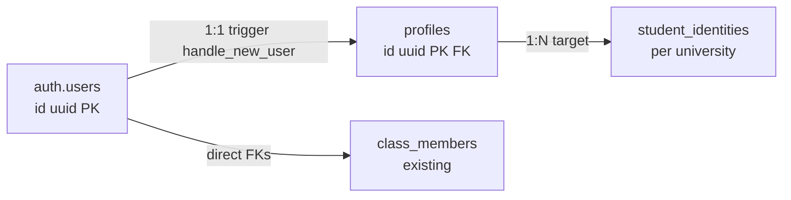

# 07 — Domain A: Global Identity

> **Status:** DRAFT. **Decisions:** CONFIRMED = brief decision; RECOMMENDED = proposal needing owner sign-off; VERIFIED = repo evidence.

## 7.1 Canonical user id (CONFIRMED + VERIFIED)

- **CONFIRMED:** one global user account across universities.
- **VERIFIED:** canonical id is `auth.users.id` (uuid). `profiles.id` is 1:1 FK `REFERENCES auth.users(id) ON DELETE CASCADE` (`20261029000100_core_schema.sql`). Every FK in the system references `auth.users` or `profiles`, never a per-university id (92+ `references auth.users` occurrences across migrations).
- **RECOMMENDED:** keep `auth.users.id` as the canonical id forever; never mint application-level user ids; all per-university ids reference upward to it.

## 7.2 auth.users vs profiles vs per-university profiles

| Layer                                                 | Role                                                              | Verified facts                                                                                                                                                                                                                                                                                                                                                                                                                                                                                                                                      |
| ----------------------------------------------------- | ----------------------------------------------------------------- | --------------------------------------------------------------------------------------------------------------------------------------------------------------------------------------------------------------------------------------------------------------------------------------------------------------------------------------------------------------------------------------------------------------------------------------------------------------------------------------------------------------------------------------------------- |
| `auth.users` (Supabase Auth)                          | Authentication only: email, OAuth identities, MFA, refresh tokens | Google OAuth configured in `supabase/config.toml` (`auth.external.google`, env credentials). JWT expiry 3600. VERIFIED present.                                                                                                                                                                                                                                                                                                                                                                                                                     |
| `profiles`                                            | Global display identity, one row per user                         | Columns VERIFIED: `id`, `display_name` (CHECK 1–80), `avatar_url` (https CHECK), `created_at`, `updated_at` (trigger `profiles_set_updated_at`), plus onboarding cols `full_name`, `nickname`, `nim`, `university`, `declared_class_name`, `onboarded_at` (`20261029002700_profile_onboarding.sql`), `bio` (`20261029003100_profile_bio.sql`). **Privacy rule (VERIFIED, `20261029002700` header):** `full_name` and `nim` are never granted to `anon`/`authenticated` — reachable only via SECURITY DEFINER functions that re-derive `auth.uid()`. |
| Per-university profile (`student_identities`, target) | Academic persona: NIM, entry year, program, verification state    | **NEW (RECOMMENDED)** — see `11-student-identity.md`. No equivalent row exists today.                                                                                                                                                                                                                                                                                                                                                                                                                                                               |

- **RECOMMENDED:** `profiles` stays GLOBAL (display identity). Per-university academic facts move to `student_identities` (one global → N per-university). `profiles.university` and `profiles.nim` free-text columns are DEPRECATED after backfill (orphaned values flagged, not auto-mapped — see `30-data-migration-strategy.md`).

## 7.3 Multi-provider representation

- **VERIFIED:** only Google OAuth is configured (`supabase/config.toml`, `[auth.external.google]`, env-injected client id/secret). `enable_signup = true`, `enable_anonymous_sign_ins = false`.
- **UNRESOLVED:** password / email / other OAuth providers. No provider-specific columns exist in `profiles`; provider identity lives in `auth.users`/`auth.identities` (Supabase Auth schema, out of scope).
- **RECOMMENDED:** no `profiles` change for future providers; `handle_new_user()` trigger remains provider-agnostic. Multi-provider account linking follows Supabase Auth `identities` semantics (ASSUMED Supabase convention; VERIFY against Supabase docs before relying).

## 7.4 Disabled-account behavior

- **VERIFIED:** no `profiles.status` / `auth.users.disabled` column was found in migrations; suspension/deletion is expressed as absence of row or `ON DELETE CASCADE` from `auth.users`.
- **UNRESOLVED:** whether a "disabled" global state (login blocked, data retained) is needed. No evidence of such a feature.
- **RECOMMENDED:** disabled state lives at the **per-university** level (`student_identities.status = suspended`), not global. Global deletion cascades (existing behavior) and is destructive — document as intentional.

## 7.5 Academic history retention

- **VERIFIED pattern:** cascading deletes (`auth.users` → `profiles`/`class_members`/`class_admins`/`assignments.user_id`) remove membership rows, but `audit_logs.actor_id` is `SET NULL` and `classes.created_by` is `SET NULL` (`20261029000900_classes.sql`) — i.e., history survives via audit + provenance columns while membership rows do not.
- **RECOMMENDED:** explicitly retain: `audit_logs`, `assignment_reviews`, `leave_request_history`, `attendance_correction_audits`, `grade_history` (target) referencing actors via `SET NULL` so history outlives the user row. Membership/offering rows may cascade or be soft-removed (`left_at`) per domain decision (`12`, `13`).

## 7.6 Global vs per-university field separation (RECOMMENDED)

| Field                                                                                                   | Scope                                                           | Rationale                                                                                                                                                                |
| ------------------------------------------------------------------------------------------------------- | --------------------------------------------------------------- | ------------------------------------------------------------------------------------------------------------------------------------------------------------------------ |
| `display_name`, `avatar_url`, `bio`                                                                     | GLOBAL (`profiles`)                                             | Presentation identity; no academic meaning.                                                                                                                              |
| `email` (via `auth.users`)                                                                              | GLOBAL                                                          | Auth identity.                                                                                                                                                           |
| `full_name`, `nickname`                                                                                 | GLOBAL (`profiles`) — keep, **do not** duplicate per-university | Legal/preferred name is person-level. ASSUMED; if universities need distinct legal names, add snapshot columns to `student_identities.full_name_snapshot` (RECOMMENDED). |
| `nim` → `student_id_number`, `university` → `university_id`, `entry_year`, `program/unit`, `verified_*` | PER-UNIVERSITY (`student_identities`)                           | Academic facts differ per institution. `profiles.nim`/`university` free text MUST be retired (see `11`).                                                                 |
| Roles/permissions                                                                                       | PER-UNIVERSITY                                                  | CONFIRMED: independent per-university roles + permissions. Class Admin perms are class-scoped (see `15`).                                                                |
| `onboarded_at`, `declared_class_name`                                                                   | GLOBAL onboarding (VERIFIED existing)                           | Onboarding gate is global; declared class text is untrusted input (auto-matching via `join_class_by_name`, `20261029002700`).                                            |

## 7.7 Security notes

- `full_name`/`nim` never exposed via PostgREST (VERIFIED privacy rule) — preserve this in target design.
- Never SELECT `*` across the server-client boundary (AGENTS.md §7.1); return only needed fields.
- `handle_new_user()` trigger provisions `profiles` from `auth.users` — SECURITY DEFINER, must keep `search_path = ''` (see `24`).

> WHY: separating global presentation identity from per-university academic identity is what makes the CONFIRMED "one account, independent per-university membership" model expressible in FKs rather than in application code.

**Cross-refs:** `06` (Domain A row), `08` (tenant root), `11` (student identity), `23` (tenant classification: `profiles` = GLOBAL, `student_identities` = TENANT_OWNED), `26` §26.1, ADR-001, `36` open items 7/9.
