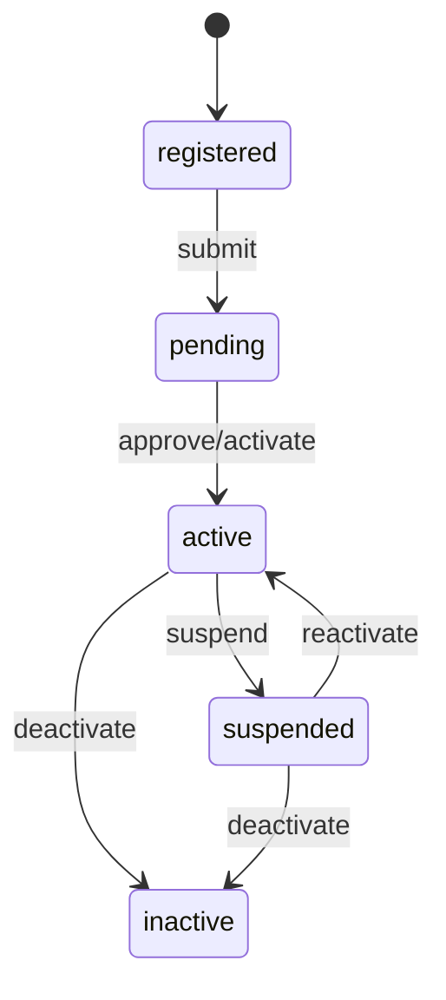

# 08 — Domain B: University Registry & Tenant Model

- **Decision: CONFIRMED** — universities centrally managed by Platform Admin; user-created universities forbidden; master registry may include non-active universities; only Platform Admin activates.
- **Existing equivalent:** **none** — VERIFIED ABSENT (no `universities` table; `profiles.university` free text only). This is the Phase 4C greenfield domain.
- **Lifecycle (CONFIRMED):** `registered → pending → active → suspended → inactive`. "Registered" includes non-active universities in the master registry; activation is Platform-Admin-only.
- **Single-table vs separate tenant table (RECOMMENDED):** **single-table `universities` with lifecycle status + `timezone` + `locale` columns** (simplest; satisfies add-suspended/inactive without extra joins). A separate tenant table adds operational cost with no current scale need (RECOMMENDED; ADR-002 PROPOSED→APPROVED pending owner sign-off).
- **Entities (target):** `universities(id, name, short_code unique, status, timezone, locale, created_at, ...)`.
- **Tenant tagging (see `23-…`):** every tenant-owned table carries `university_id` (direct where the row is authored in that university; inherited/composite where derived).
- **Platform Admin ops:** create/edit/suspend/activate via `platform_admins`-gated RPCs; audit-logged.
- **Open:** import of legacy `profiles.university` strings into registry rows (mapping is fuzzy — UNRESOLVED; see `30-data-migration-strategy.md`).

> WHY single table: tenancy lifecycle is orthogonal to academic data; a separate table forces double-joins on every tenant-scoped query for one benefit (independent lifecycle) already expressible as a status.
