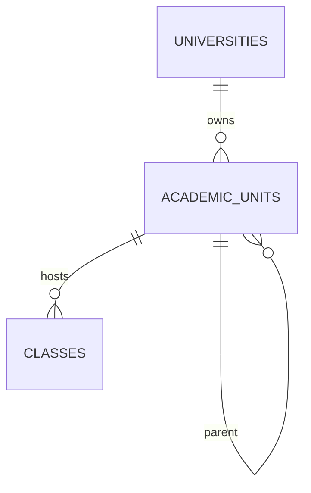

# 09 — Domain C: Academic Organization (Flexible Units)

- **Decision: CONFIRMED** — academic structure must be flexible (not forced faculty/department); don't hardcode Indonesian-only.
- **Options considered:**
  1. *Fixed hierarchy* (`faculties → departments → programs`) — **rejected** (forces Indonesian/MI model on all universities).
  2. *Flexible adjacency* (parent pointer + free `unit_type`) — works but makes subtree queries acyclicity checks hard.
  3. *Generalized unit model* with `unit_type` + configurable hierarchy — **RECOMMENDED**.
- **RECOMMENDED:** `academic_units(id, university_id, parent_id nullable, unit_type free text with seed values {faculty, dept, program, branch}, name, short_code, status)` with a `ltree`/recursive-CTE closure or a maintained `path` column for subtree queries (RECOMMENDED `path` text + GIST later; start simple).
- **Existing equivalent:** `courses.department` free-text (VERIFIED) — to be deprecated in favour of unit linkage (MODIFY/MERGE, see `29`).
- **Lifecycle:** draft → active → archived; `parent_id` changes are audited.

> WHY generalized: CONFIRMED flexibility requirement; a fixed hierarchy cannot express non-Indonesian structures.
