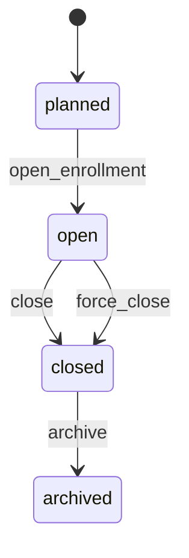

# 10 — Domain D: Academic Period

> **Status:** DRAFT. **CONFIRMED** = brief decision; VERIFIED = repo evidence.

## 10.1 What "academic year / semester" means today (VERIFIED)

- `assignments.semester text` + `assignments.academic_year text CHECK ~ ^\d{4}/\d{4}$` (`20261029000100_core_schema.sql`).
- `classes.semester text NOT NULL` + `classes.academic_year text NOT NULL CHECK ^\d{4}/\d{4}$` (`20261029000900_classes.sql`).
- `class_course_schedules` weekly rows span a semester range (`20261105000000_class_schedule_semester_range.sql`).
- **No first-class period entity exists.** Semester/year are free text stored per row — hence the target model below.

## 10.2 Target definition (RECOMMENDED)

`academic_periods(id, university_id, name, code, start_date, end_date, enrollment_open bool, status, created_at, updated_at)`:

| Field                    | Meaning                                                                                                |
| ------------------------ | ------------------------------------------------------------------------------------------------------ |
| `name`                   | Human label, e.g. "Fall 2026 / Semester 1" (free text, per university)                                 |
| `code`                   | Short code, e.g. `2026-1` — UNIQUE per university                                                      |
| `start_date`, `end_date` | `date` (not `timestamptz`): the teaching window; instances derive instants via `universities.timezone` |
| `enrollment_open`        | Batch-level gate (offering-level gate is on `course_offerings.status`)                                 |
| `status`                 | `planned → open → closed → archived`                                                                   |

## 10.3 Active vs historical

- `planned`: future period, offerings may be created but not yet enrolled.
- `open`: enrollment + attendance active.
- `closed`: no new enrollments; attendance read-only; grades may still be published.
- `archived`: historical; included in stats/reports, excluded from defaults/schedules.
- **Single active period per university at a time is NOT enforced** (universities may overlap intakes) — RECOMMENDED: no global "current period" singleton; consumers filter `status = 'open'`. (If intake overlap is deemed invalid, add a partial-unique index in Phase 5A — currently UNRESOLVED.)

## 10.4 Transitions

- Transitions via SECURITY DEFINER RPCs + `audit_logs` rows (pattern VERIFIED from class lifecycle `20261031180000_class_lifecycle.sql`).
- Closing a period does NOT delete offerings/attendance/grades; it freezes writes (RLS/RPC checks `period.status`).

## 10.5 Per-university calendars + different year-start months

- **CONFIRMED:** timezone per university is on `universities.timezone` (IANA, e.g. `Asia/Jakarta`); periods store `date` only, never instants, so a university whose academic year starts August vs January is just a different `start_date` — no code change.
- Different year-start months across universities are therefore represented by data, not schema variants.
- `universities.timezone` is the source of truth for materializing schedule instances (`19-schedule.md`); each rule snapshots it at creation to survive later timezone corrections.

## 10.6 Relationship to Entry Year (CONFIRMED separation)

- Entry Year is a **fixed cohort attribute on `student_identities.entry_year`** (see `11`), NOT derived from the period in which the student is currently enrolled.
- Example: a student with `entry_year = 2024` may enroll in a `2026-1` period (retake / delayed graduation) without changing cohort identity. Brief CONFIRMS this independence.

## 10.7 Migration note

- Existing `semester`/`academic_year` text values are retained as legacy columns during expand-contract; `academic_periods` backfill is Platform-Admin-driven (no auto-mapping from free text — see `30`).
- `assignments.semester`/`academic_year` free text MUST NOT be used for new queries; new code joins via `offering_id → academic_period_id`.

**Cross-refs:** `06`, `08` (timezone), `09` (units), `11` (entry year), `13` (offerings reference periods), `19` (schedule), `26` §26.1, `36` item 9.
