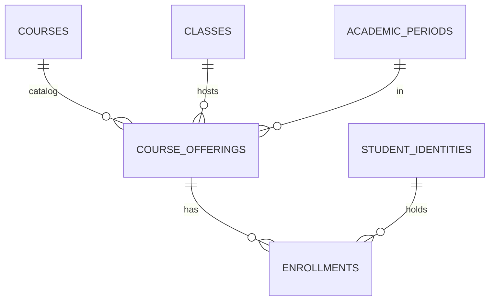

# 13 — Domain G: Course Catalog vs Offering vs Enrollment

- **Decision: CONFIRMED** — Course = subject (Database Systems); one class → many courses; course enrollment independent of home class (retake without changing home class/Entry Year).
- **RECOMMENDED three-layer split:**
  1. **Catalog** `courses` (global catalogue, KEEP from existing `courses`; tenant catalogue per university is UNRESOLVED — see below).
  2. **Offering** `course_offerings` (class × subject × period) — maps to existing `class_subjects` (MERGE/RENAME, see `29`). Covers auto-access for home class members.
  3. **Enrollment** `enrollments` (student identity × offering) — maps to existing `class_subject_members` (RENAME + widen, see `29`). Covers retake enrollment.
- **Lifecycle:** offering draft → open → closed; enrollment active → dropped/completed.
- **Home-class auto access (CONFIRMED):** home-class members see all home offerings without an `enrollments` row (RECOMMENDED derived access via membership, not materialized rows). Retake enrollments always have explicit rows.
- **Catalog scope:** existing `courses` is **global** (deduplicated by `normalized_name`). Per-university catalogues (same name, different universities) need `university_id` on catalog rows — **UNRESOLVED** pending product decision (catalog may intentionally be shared with course-code scoping). Default RECOMMENDED: keep catalogue global + `university_id` nullable with migration adding NOT NULL later, OR tenant catalogue — flagged as UNRESOLVED in `36`.

> WHY three layers: catalog deduplication (subject) vs offering (cohort×period) vs enrollment (student×offering) collapse three independent lifecycles into one table today and force retake hacks.
