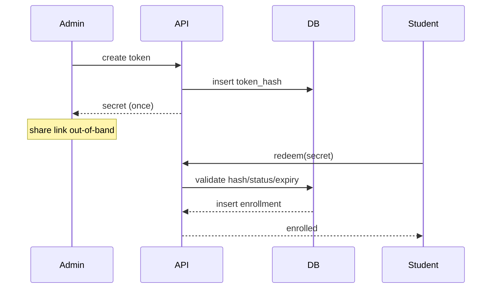

# 14 — Domain H: Course Invitation (Secure Tokens)

- **Decision: CONFIRMED** — Course Invitation Link: any Class Admin of the class can create; course-specific; direct enroll; no approval; doesn't change home class/Entry Year; recorded independently.
- **Existing equivalent:** `class_invitations` (class-level tokens) — VERIFIED. Course-scoped tokens are **NEW** (RECOMMENDED new table; class-level table KEEP and untouched).
- **Target:** `course_invite_tokens(id, offering_id, created_by_admin_id, token_hash (SHA-256 of random secret — never store plaintext), expires_at nullable, max_uses nullable, use_count, status: active/revoked/expired/exhausted, created_at, revoked_at, audit trail)`.
- **Token lifecycle:**
  1. Generate: 32 random bytes → `base64url` secret shown once; store `SHA-256(secret)` only.
  2. Validate: `H(token)` lookup + status + expiry + use-limit check in one SECURITY DEFINER RPC.
  3. Redeem: inserts `enrollments` row (or returns existing), increments use_count, records acceptance with timestamp + redeemer identity.
  4. Revoke: any Class Admin of the class sets `revoked_at` (audited); redeem then fails closed.
  5. Expiry: `expires_at` enforced in RPC, plus periodic cron sweep (API cron pattern, VERIFIED).
- **Usage default (RECOMMENDED):** **single-use or small batch-friendly with optional `max_uses`** — default `max_uses = NULL` (unlimited) is a risk; RECOMMENDED default **10 uses / 30-day expiry** to balance shareability vs leakage, each token independently revocable (RECOMMENDED, needs approval — usage policy NOT locked).
- **No approval, no home-class change (CONFIRMED):** redeem creates only an `enrollments` row.

