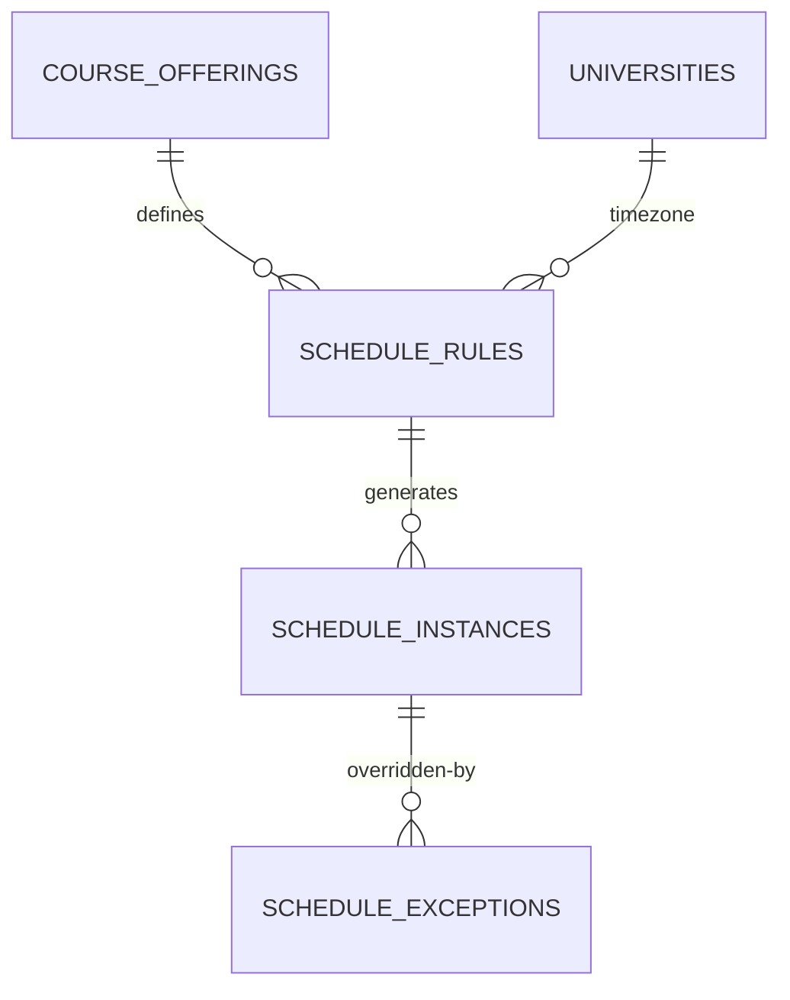

# 19 — Domain M: Schedule

- **Decision: CONFIRMED** — schedule is its own domain; recurrence vs meetings vs exceptions; timezone per university.
- **Existing equivalent:** `class_course_schedules` (weekly rows, VERIFIED) + `personal_calendar_events` + `class_calendar_events` (VERIFIED). Existing model is **weekly-row only** — no recurrence/exception distinction (gap).
- **Target (RECOMMENDED):**
  - `schedule_rules(offering_id, weekday, start_time, end_time, room, timezone — snapshot of university timezone at rule creation)`.
  - `schedule_instances(rule_id, date, status: scheduled/cancelled/moved, override fields)` — materialized per period.
  - `schedule_exceptions(instance_id, kind: cancel/move/substitute, note, created_by)`.
- **Timezone (CONFIRMED per university):** store `universities.timezone` (IANA, e.g. `Asia/Jakarta`); rules store local wall-time + timezone name; instances materialize to `timestamptz`.
- **Existing parity:** `academic_calendar.sql` (20261029003900) covers events; `SCHEDULE_PDF_IMPORT.md` (docs) suggests PDF schedule import exists in UI (candidate; schema evidence = `class_course_schedules` rows).

