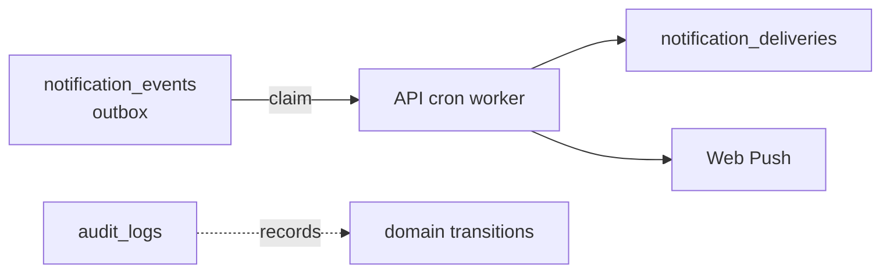

# 22 — Domains P & Q: Notifications & Audit

## P — Notifications (existing: KEEP)

- Tables VERIFIED: `notification_events` (outbox) + `notification_deliveries` + `notification_preferences` + `push_subscriptions`.
- Pattern: `claim_notification_events()` / `complete_notification_event()` (+ delivery equivalents) consumed by API cron `notification-events` (VERIFIED routes). Web Push via VAPID (server-only keys, AGENTS.md §7).
- Target: add `university_id` (derived from source row) for tenant-scoped fan-out; keep outbox pattern.

## Q — Audit (existing: KEEP)

- Table VERIFIED: `audit_logs` + `record_audit()` (internal-only, class_functions comment).
- Target: `audit_logs(id, university_id nullable, actor_user_id, action, target_type, target_id, before jsonb, after jsonb, created_at)` append-only (REVOKE UPDATE/DELETE from authenticated/service_role consumer paths; service_role retain is UNRESOLVED operational choice).
- Domain-specific history stays in `attendance_corrections`, `grade_history`, `leave_request_history` (VERIFIED pattern); `audit_logs` is the cross-cutting record.

