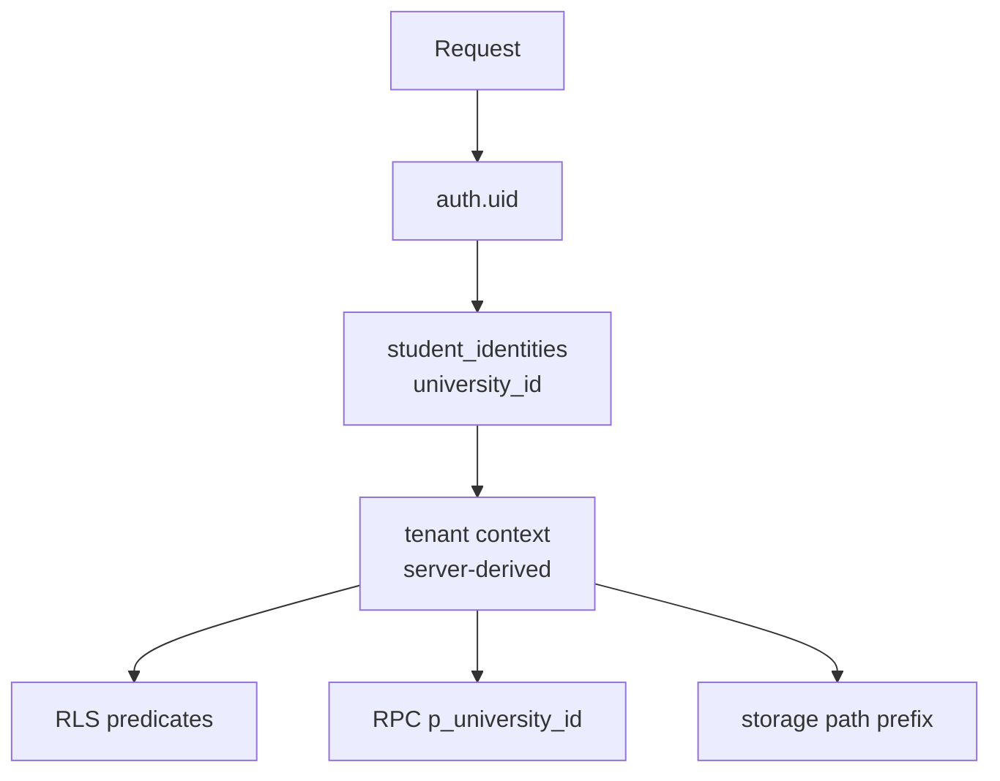

# 23 — Multi-Tenant Security Architecture

> **Status:** DRAFT. **Tenant root (RECOMMENDED, ADR-002):** single `universities` table (see `08`).

## 23.1 Tenant classification per table

| Classification         | Meaning                                                                | Examples (existing → target)                                                                    |
| ---------------------- | ---------------------------------------------------------------------- | ----------------------------------------------------------------------------------------------- |
| GLOBAL                 | No tenant; platform-wide                                               | `platform_admins`, `rate_limits`, `courses` (catalogue, pending UNRESOLVED), `app_error_events` |
| TENANT_OWNED           | Row authored in exactly one university; carries direct `university_id` | `classes`, `academic_units`, `course_offerings`, `announcements`, `course_invite_tokens`        |
| TENANT_DERIVED         | Tenant inherited through parent (composite FK enforces it)             | `enrollments` (via offering), `attendance_records` (via meeting→offering), `course_materials`   |
| CROSS_TENANT_REFERENCE | Points at a GLOBAL row                                                 | `assignments.course_id → courses`, `course_offerings.course_id`                                 |
| PLATFORM_CONTROLLED    | Written only by platform machinery                                     | `audit_logs` (internal RPC), `notification_events` (internal), `auth_activity_events`           |

## 23.2 Direct vs inherited keys

- **Direct `university_id`** RECOMMENDED for TENANT_OWNED tables (simple RLS: `university_id = current_university()`, indexable, auditable).
- **Inherited via composite FK** RECOMMENDED for TENANT_DERIVED tables to avoid denormalized drift: e.g. `enrollments` carries `(offering_id, university_id)` with `FOREIGN KEY (offering_id, university_id) REFERENCES course_offerings(id, university_id)` — DB rejects cross-tenant pairings even if app bugs exist.

```sql
-- Conceptual example (target design, NOT to be run as-is)
CREATE TABLE course_offerings (
  id uuid PRIMARY KEY DEFAULT gen_random_uuid (),
  university_id uuid NOT NULL REFERENCES universities (id),
  class_id uuid NOT NULL REFERENCES classes (id),
  course_id uuid NOT NULL REFERENCES courses (id),
  academic_period_id uuid NOT NULL REFERENCES academic_periods (id),
  UNIQUE (id, university_id) -- enables composite FKs from children
);

CREATE TABLE enrollments (
  id uuid PRIMARY KEY DEFAULT gen_random_uuid (),
  offering_id uuid NOT NULL,
  university_id uuid NOT NULL,
  student_identity_id uuid NOT NULL,
  FOREIGN KEY (offering_id, university_id) REFERENCES course_offerings (id, university_id) ON DELETE CASCADE
);
```

## 23.3 Tenant-scoped uniqueness matrix (RECOMMENDED)

| Scope                 | Examples                                                                                                                                                                                                                            |
| --------------------- | ----------------------------------------------------------------------------------------------------------------------------------------------------------------------------------------------------------------------------------- |
| Global unique (KEEP)  | `platform_admins.user_id`, `courses.normalized_name` (until catalogue scope decided)                                                                                                                                                |
| Per-university unique | `student_identities (university_id, student_id_number)`, `classes (university_id, home_code)`, `academic_units (university_id, parent_id, short_code)`, `course_offerings (university_id, class_id, course_id, academic_period_id)` |
| Per-class unique      | `class_admin_assignments (class_id, student_identity_id)` active                                                                                                                                                                    |
| Per-offering unique   | `enrollments (offering_id, student_identity_id)` active                                                                                                                                                                             |

## 23.4 Tenant lifecycle

`registered → pending → active → suspended → inactive` (CONFIRMED). Single `universities` table with `status` column (RECOMMENDED simplest — ADR-002). Suspended universities: reads halted via RLS `university_status = 'active'` guard (RECOMMENDED); data retained (no cascade).

## 23.5 Tenant context propagation

1. **Server Components:** resolve tenant from session → `student_identities` membership; never trust client `university_id` (AGENTS.md §7).
2. **Server Actions / Route Handlers:** derive `university_id` server-side; validate every `target_id` belongs to that tenant via composite-FK RPCs.
3. **RPC:** SECURITY DEFINER functions take `p_university_id` and verify `is_platform_admin()` OR tenant membership before touching tenant rows; `SECURITY INVOKER` preferred where RLS already guards.
4. **Storage:** bucket stays shared; object path prefixed with `university_id`; policy checks path prefix + membership.


