# 28 — Entity-Relationship Diagrams (Target, 16 Diagrams)

> **Status:** DRAFT / PROPOSED. Mermaid `erDiagram` matching `26-target-database-schema.md`. Dashed = proposed/candidate.

## 1. Platform & tenant root

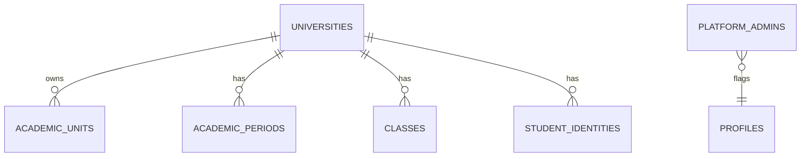

## 2. Academic organization

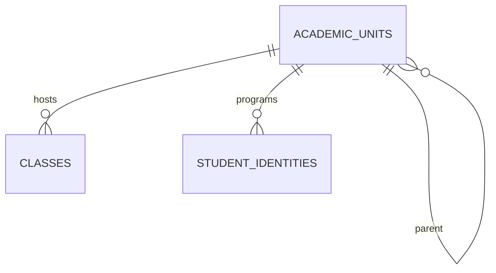

## 3. Identity

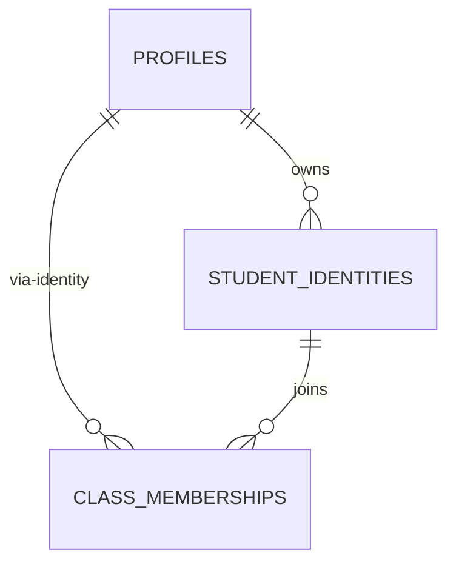

## 4. Class & membership

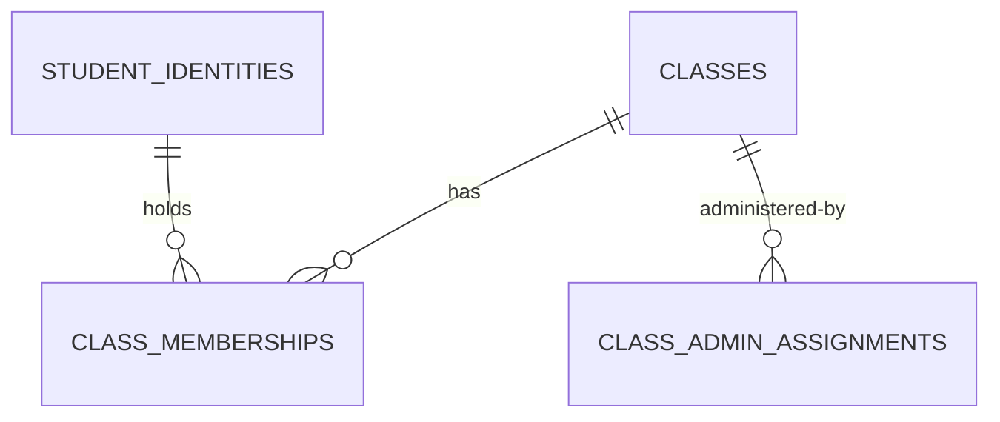

## 5. Course catalog → offering → enrollment

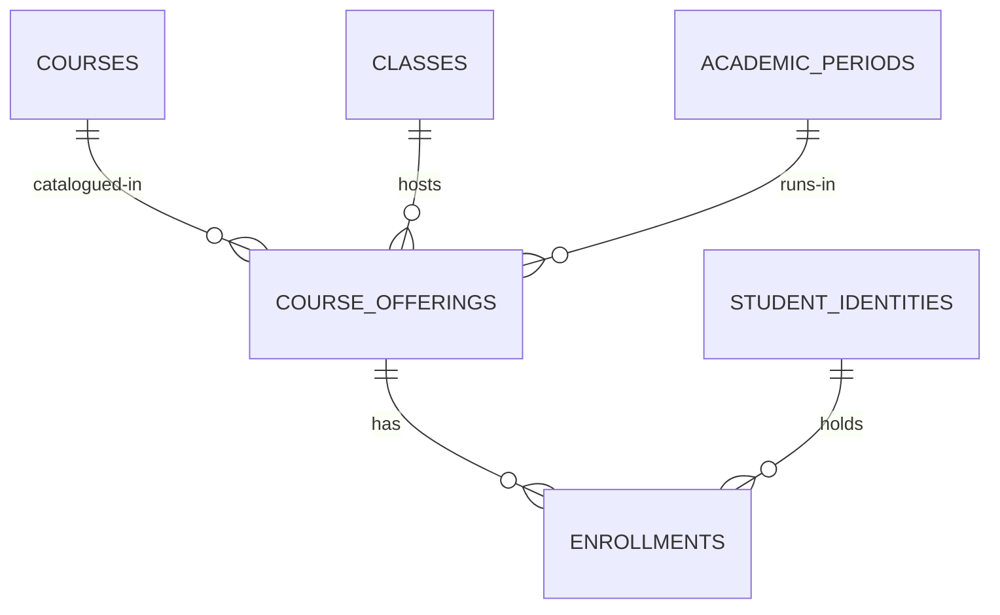

## 6. Course invitation

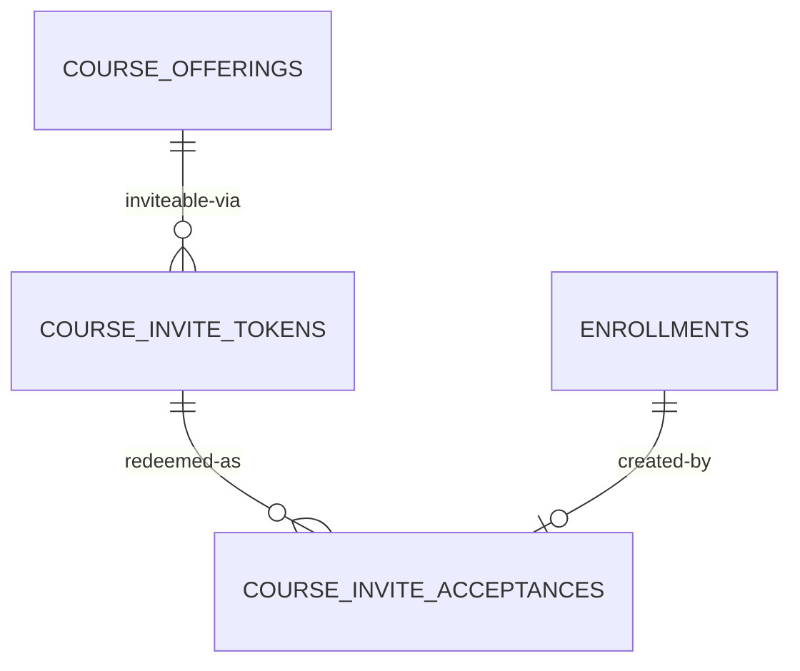

## 7. Class Admin RBAC

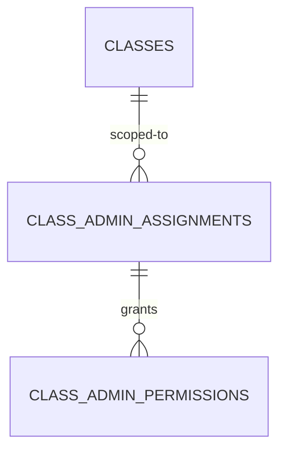

## 8. Assignments & materials

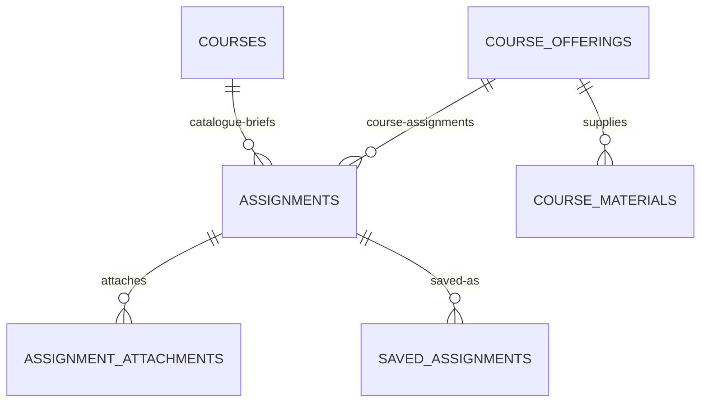

## 9. Attendance

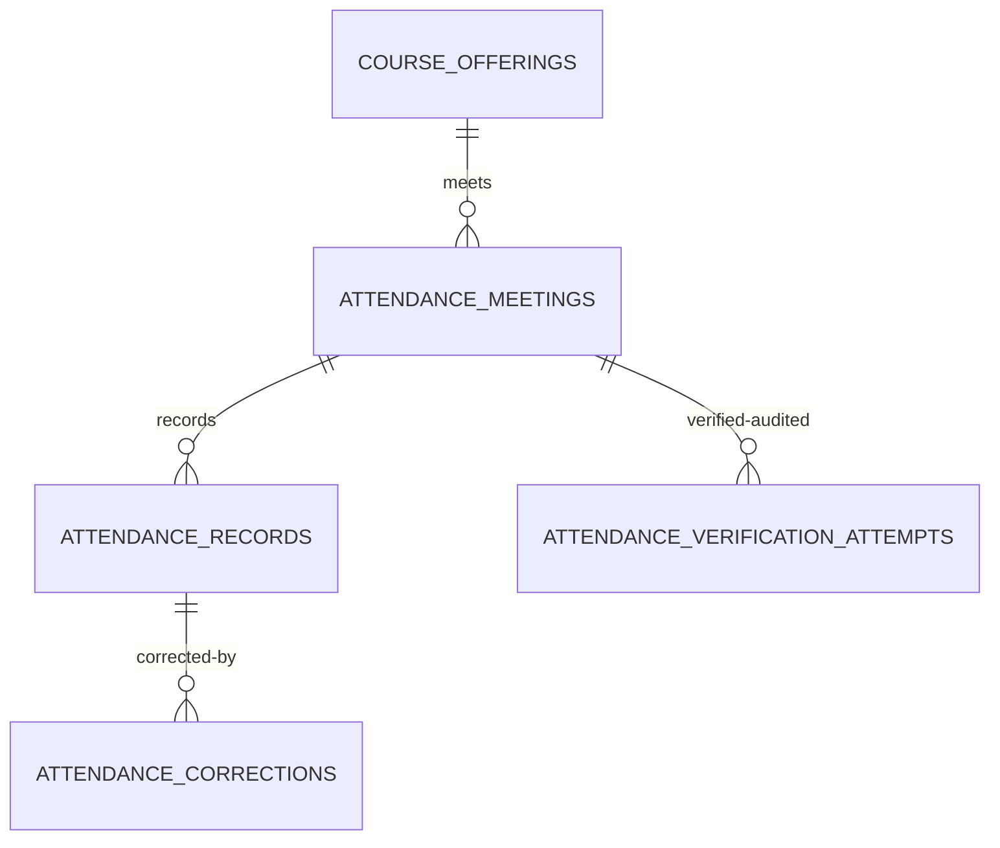

## 10. Grading

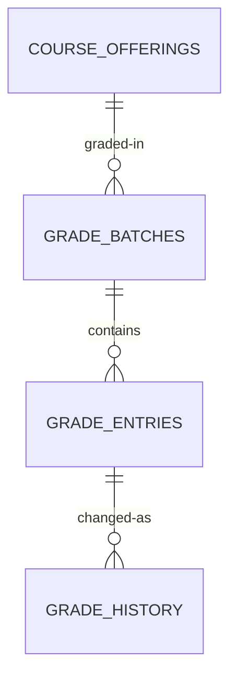

## 11. Schedule

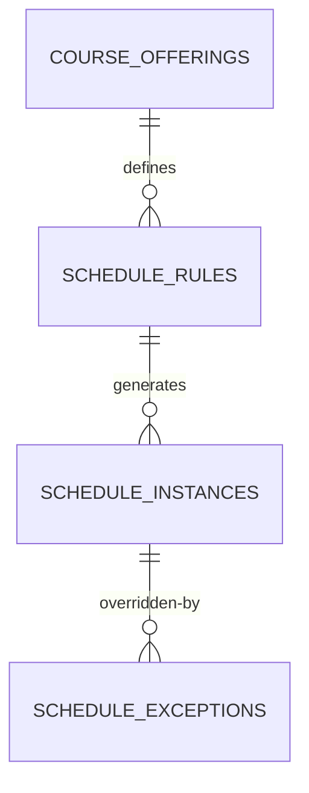

## 12. Leave (existing, kept)

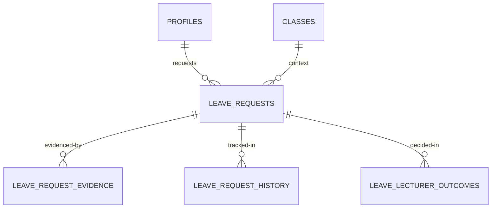

## 13. Sessions & calendar (existing)

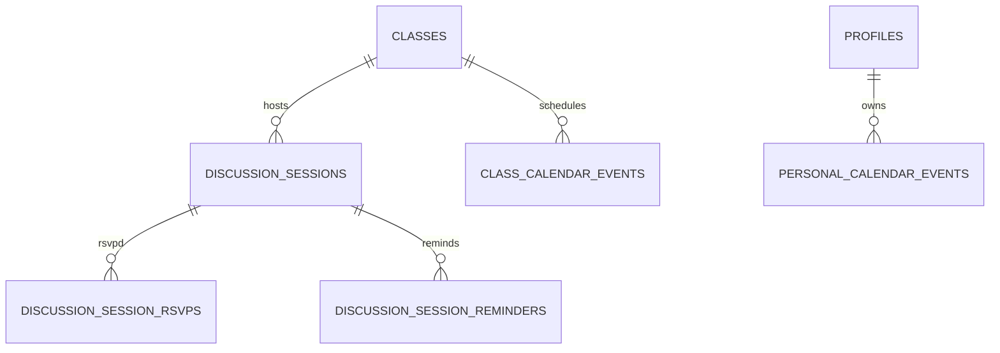

## 14. Announcements & discussions

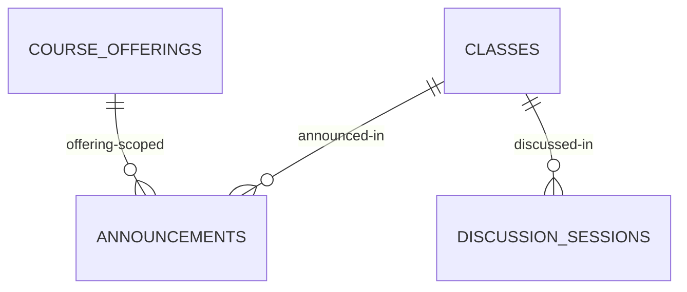

## 15. Notifications

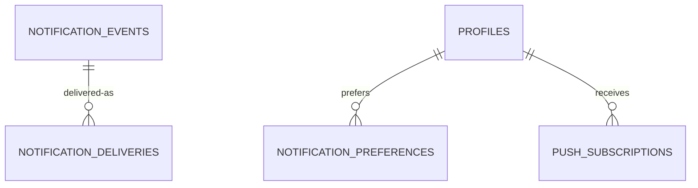

## 16. Audit & monitoring

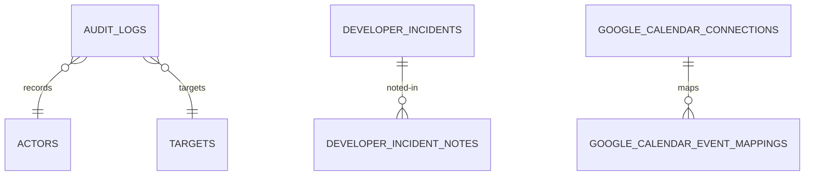

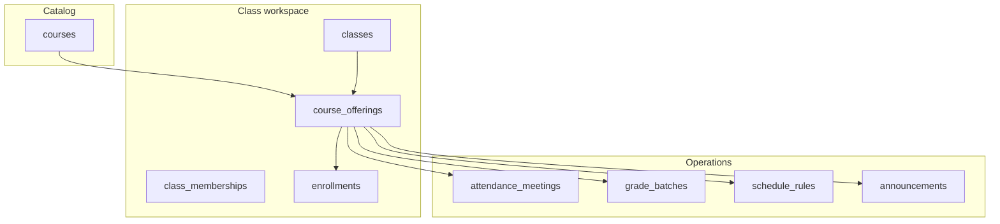
