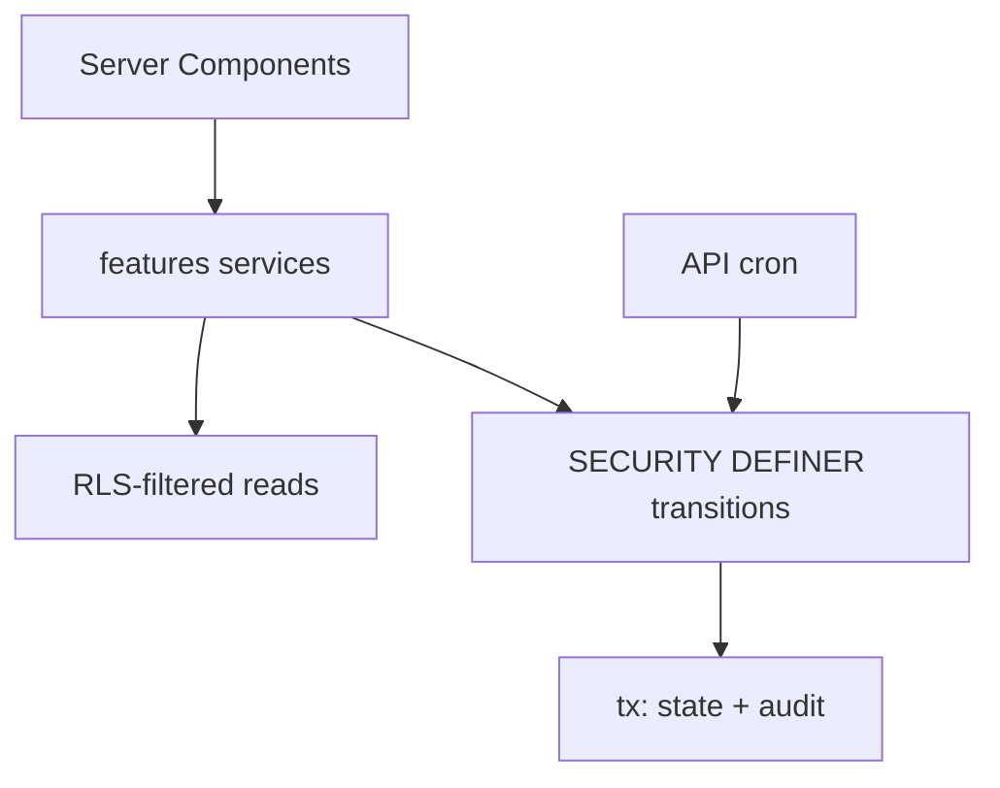

# 31 — Application Architecture Alignment

## 31.1 Responsibility boundaries (RECOMMENDED)

| Layer                              | Owns (RECOMMENDED)                                                                                                   | Must never own                                 |
| ---------------------------------- | -------------------------------------------------------------------------------------------------------------------- | ---------------------------------------------- |
| Postgres constraints               | Uniqueness, FK integrity, composite-FK tenant pairing, status enums, last-admin guard (trigger), append-only history | Business workflow sequencing                   |
| RLS                                | Row visibility (tenant + membership predicates)                                                                      | Complex orchestration                          |
| SECURITY DEFINER functions         | Atomic state transitions + audit + token redemption                                                                  | Pure reads better served by RLS + typed client |
| Services (`features/*-service.ts`) | Multi-step orchestration, validation, notifications enqueue, CSV parse coordination                                  | SQL fragments                                  |
| Workers (API cron)                 | Retention, fan-out, instance materialization (chunked)                                                               | User-facing mutations                          |

## 31.2 Patterns

- **Reads:** Server Components → Supabase client (RLS-filtered) → contracts validators. No `select *` across server-client boundary (AGENTS.md §7.1).
- **Writes/transactions:** every state transition = one SECURITY DEFINER RPC + `audit_logs` row in the same tx (existing VERIFIED pattern).
- **Auth:** `auth.uid()` server-derived; never trust client user/tenant IDs.
- **Bulk attendance:** admin records in bulk via `record_attendance_bulk(p_meeting_id, p_rows[])` RPC (single tx, one audit row per batch + per-record history) — RECOMMENDED over per-row client writes.
- **CSV import (grading):** upload → staging (grade_batches/entries unpublished) → verify → publish RPC; file hash stored for idempotency.
- **Enrollment:** home-class auto access (derived) vs explicit `enrollments` for retake/invite (see `13`).
- **Feed:** announcements (formal, push fan-out) vs discussions (threads) vs social (candidate) — separate services (see `21`).

