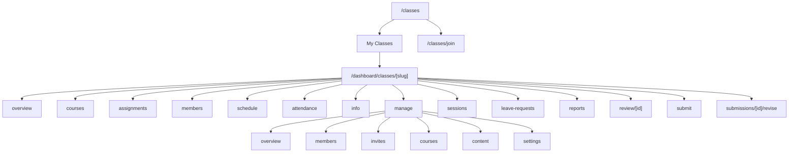
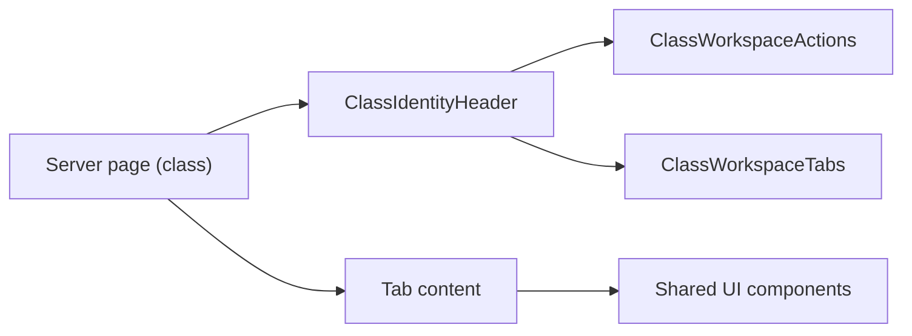
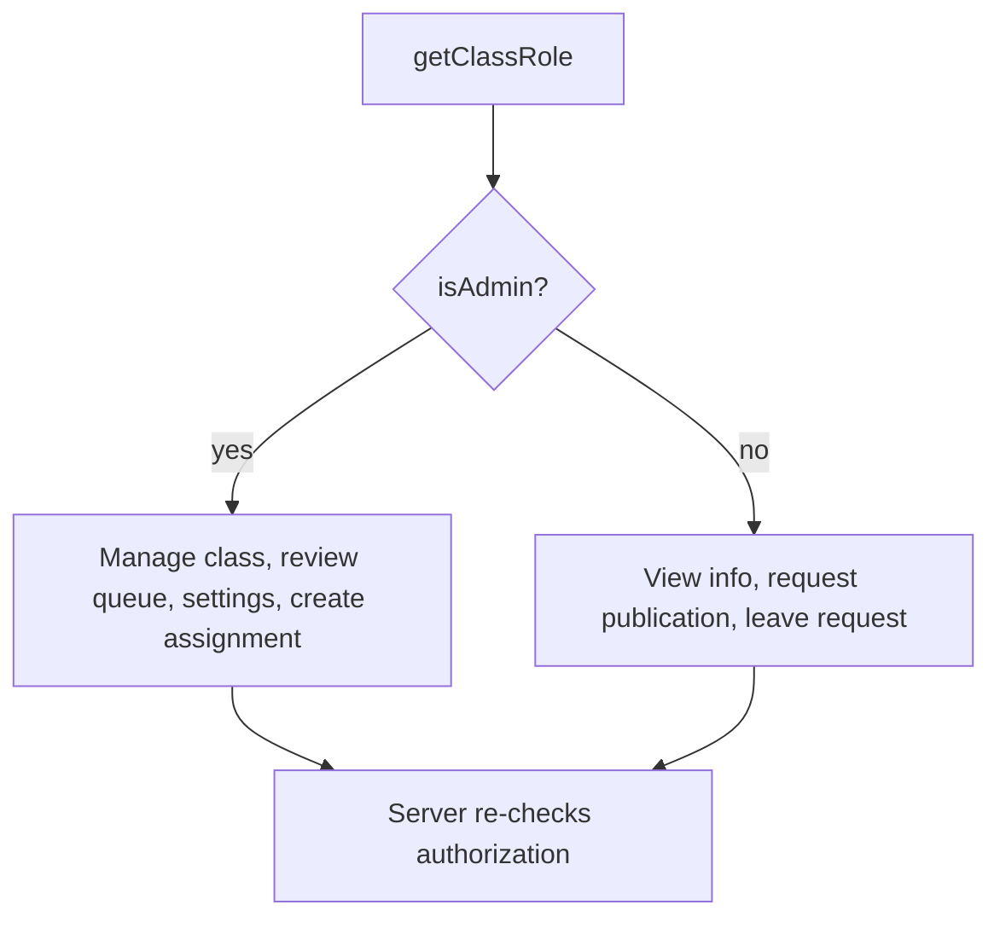
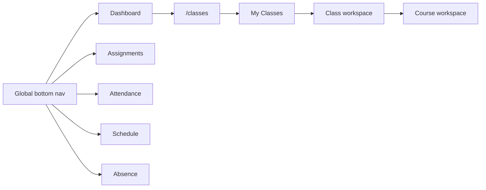

# Class Module Architecture

Last updated: 2026-11-04

## Page hierarchy

## Shared chrome

## Role-based UI

Class Admin is class-scoped. The frontend never enforces security alone; RLS and server checks are the boundary.

## Responsive layout strategy

- `contents xl:*` wrappers make the two-column desktop layout collapse into one ordered mobile column.
- No client-side layout branching; CSS only.
- Data fetching happens once per server page.

## Navigation

## Workflows

- Create assignment: class tab → submit.
- Attendance: class tab → attendance workspace → meeting form.
- Schedule: class tab → schedule tab → create entry.
- Members/invites: manage tab → members/invites.
- Leave requests: class tab → leave requests.
- Review: manage content → review queue.
