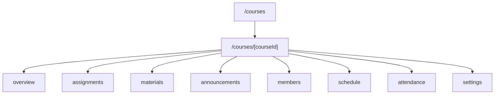
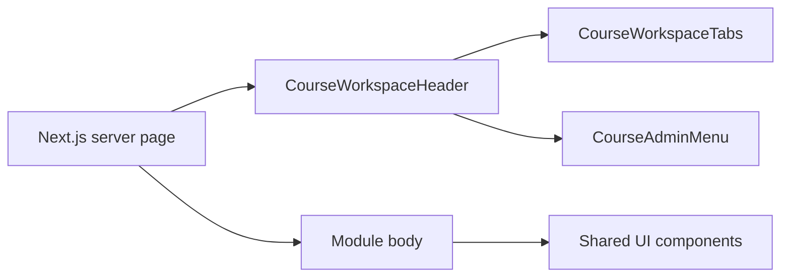

# Course Module Architecture

Last updated: 2026-11-04

## Page hierarchy

## Shared chrome

## Responsive rendering strategy

- Large screens (`lg+`): two-column layout with aside; filters visible; all sections shown.
- Small screens: sections become a single column; order is controlled with flex `order` classes; columns dissolve with `contents`.
- No client-side branching for layout; all responsive behavior is CSS.
- Data fetching happens once in the server page; components render from props.

## Navigation relationships

- Bottom navigation remains unchanged.
- Course tabs remain horizontal scrollable on narrow screens.
- Course Overview links point to existing tabs; no placeholder routes.

## State and caching

- Overview page is `force-dynamic`.
- `countCourseContent` runs in the same server request as the list queries.
- No new API endpoints were added.
