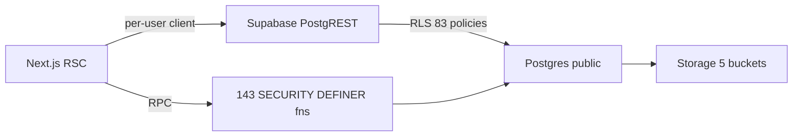

# Current Database Architecture

```mermaid
erDiagram
  auth_users ||--o| profiles : "1:1 handle_new_user"
  courses ||--o{ classes : course
  classes ||--o{ class_members : members
  classes ||--o{ class_admins : admins
  classes ||--o{ class_subjects : "KC117 etc"
  courses ||--o{ class_subjects : catalogue
  classes ||--o{ discussion_sessions : "meeting 1-13"
  class_subjects ||--o{ discussion_sessions : subject
  discussion_sessions ||--o{ discussion_session_checkins : attendance
  profiles ||--o{ discussion_session_checkins : student
  profiles ||--o{ leave_requests : student
  classes ||--o{ leave_requests : class
  leave_requests ||--o{ leave_request_evidence : files
  leave_requests ||--o{ leave_request_history : audit
  courses ||--o{ assignments : course
  classes ||--o{ assignments : class
  assignments ||--o{ assignment_attachments : files
```

## Flow



## Facts

- 52 tables, 112 FK, 18 unique, 83 RLS policies, 159 functions (143 SECURITY DEFINER).
- Storage buckets: `assignment-attachments` (priv), `avatars` (pub), `class-media` (pub), `leave-evidence` (priv), `verification-evidence` (priv).
- No `universities`/`university_memberships` tables. No `university_id` column anywhere.
- Single class in prod, 30 members, 14 sessions, 129 check-ins.
