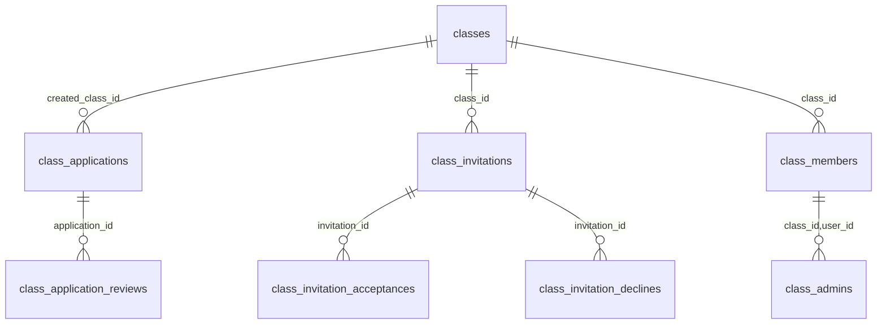
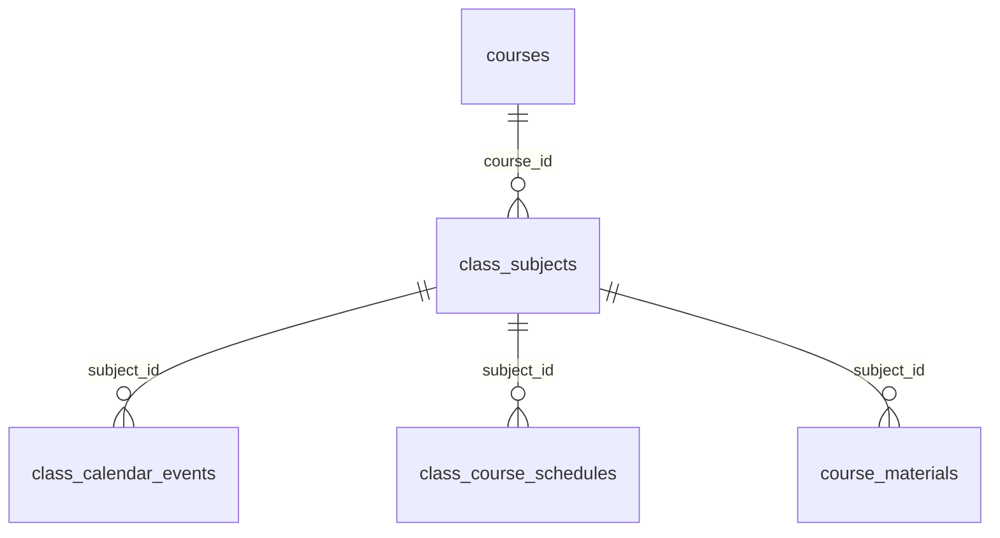
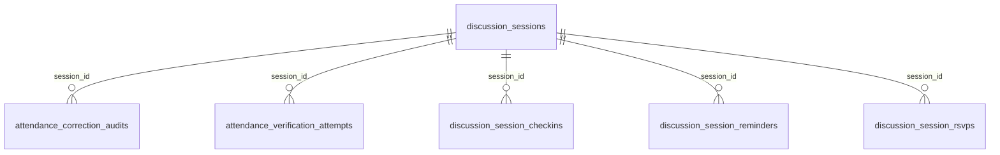
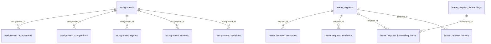

# Relationship & Foreign Key Mapping — public schema

> **Generated:** 2026-11-04 from PostgreSQL catalog dumps (local Supabase stack, PostgreSQL 17.11) + remote production cross-checks (project `kdqsrckmmoucdqiapovr`, `starstask`, ap-northeast-2).
> **Method:** read-only `COPY (... pg_catalog ...) TO STDOUT` queries; local `SELECT count(*)` per table; MCP `execute_sql` for remote counts/estimates. No DDL was executed.
> **Evidence legend:** VERIFIED = directly observed in catalog metadata; INFERRED = interpretation from names/types/app usage; UNKNOWN = insufficient evidence.
> Parent document: [DATABASE_SCHEMA_REFERENCE.md](./DATABASE_SCHEMA_REFERENCE.md)

All 112 foreign keys (VERIFIED from `pg_constraint`, contype=f).
`ON DELETE`/`ON UPDATE` decoded from confdeltype/confupdtype — PostgreSQL mapping:
`a` = NO ACTION, `r` = RESTRICT, `c` = CASCADE, `n` = SET NULL, `d` = SET DEFAULT.
(Phase 4B fix: a previous legend incorrectly read `a=CASCADE`; PostgreSQL documents `a` as
`NO ACTION`. Hence every `a` in the table below means NO ACTION — notably all `ON UPDATE`
columns, which are NO ACTION throughout, and no FK uses SET DEFAULT `d` or `r` on update.)
Distribution (VERIFIED): ON DELETE — `c` (CASCADE) 65, `n` (SET NULL) 43, `r` (RESTRICT) 4;
ON UPDATE — `a` (NO ACTION) 112. Deferrable/initially-deferred from condeferrable/condeferred.

| Constraint                                        | Source                                               | Target                                  | ON DELETE | ON UPDATE | Deferrable | Initially deferred |
| ------------------------------------------------- | ---------------------------------------------------- | --------------------------------------- | --------- | --------- | ---------- | ------------------ |
| app_activity_events_actor_id_fkey                 | public.app_activity_events(actor_id)                 | auth.users(id)                          | n         | a         | NO         | NO                 |
| app_activity_events_class_id_fkey                 | public.app_activity_events(class_id)                 | public.classes(id)                      | n         | a         | NO         | NO                 |
| assignment_attachments_assignment_id_fkey         | public.assignment_attachments(assignment_id)         | public.assignments(id)                  | c         | a         | NO         | NO                 |
| assignment_completions_assignment_id_fkey         | public.assignment_completions(assignment_id)         | public.assignments(id)                  | c         | a         | NO         | NO                 |
| assignment_completions_user_id_fkey               | public.assignment_completions(user_id)               | auth.users(id)                          | c         | a         | NO         | NO                 |
| assignment_reports_assignment_id_fkey             | public.assignment_reports(assignment_id)             | public.assignments(id)                  | c         | a         | NO         | NO                 |
| assignment_reports_class_id_fkey                  | public.assignment_reports(class_id)                  | public.classes(id)                      | c         | a         | NO         | NO                 |
| assignment_reports_reporter_id_fkey               | public.assignment_reports(reporter_id)               | auth.users(id)                          | c         | a         | NO         | NO                 |
| assignment_reports_resolved_by_fkey               | public.assignment_reports(resolved_by)               | auth.users(id)                          | n         | a         | NO         | NO                 |
| assignment_reviews_assignment_id_fkey             | public.assignment_reviews(assignment_id)             | public.assignments(id)                  | c         | a         | NO         | NO                 |
| assignment_reviews_reviewer_id_fkey               | public.assignment_reviews(reviewer_id)               | auth.users(id)                          | n         | a         | NO         | NO                 |
| assignment_revisions_assignment_id_fkey           | public.assignment_revisions(assignment_id)           | public.assignments(id)                  | c         | a         | NO         | NO                 |
| assignment_revisions_class_id_fkey                | public.assignment_revisions(class_id)                | public.classes(id)                      | n         | a         | NO         | NO                 |
| assignment_revisions_editor_id_fkey               | public.assignment_revisions(editor_id)               | auth.users(id)                          | n         | a         | NO         | NO                 |
| assignments_class_id_fkey                         | public.assignments(class_id)                         | public.classes(id)                      | n         | a         | NO         | NO                 |
| assignments_course_id_fkey                        | public.assignments(course_id)                        | public.courses(id)                      | r         | a         | NO         | NO                 |
| assignments_reviewed_by_fkey                      | public.assignments(reviewed_by)                      | auth.users(id)                          | n         | a         | NO         | NO                 |
| assignments_subject_id_fkey                       | public.assignments(subject_id)                       | public.class_subjects(id)               | n         | a         | NO         | NO                 |
| assignments_user_id_fkey                          | public.assignments(user_id)                          | auth.users(id)                          | c         | a         | NO         | NO                 |
| attendance_correction_audits_admin_id_fkey        | public.attendance_correction_audits(admin_id)        | auth.users(id)                          | n         | a         | NO         | NO                 |
| attendance_correction_audits_class_id_fkey        | public.attendance_correction_audits(class_id)        | public.classes(id)                      | c         | a         | NO         | NO                 |
| attendance_correction_audits_session_id_fkey      | public.attendance_correction_audits(session_id)      | public.discussion_sessions(id)          | c         | a         | NO         | NO                 |
| attendance_correction_audits_student_id_fkey      | public.attendance_correction_audits(student_id)      | auth.users(id)                          | c         | a         | NO         | NO                 |
| attendance_correction_audits_subject_id_fkey      | public.attendance_correction_audits(subject_id)      | public.class_subjects(id)               | n         | a         | NO         | NO                 |
| attendance_verification_attempts_session_id_fkey  | public.attendance_verification_attempts(session_id)  | public.discussion_sessions(id)          | c         | a         | NO         | NO                 |
| attendance_verification_attempts_user_id_fkey     | public.attendance_verification_attempts(user_id)     | auth.users(id)                          | c         | a         | NO         | NO                 |
| audit_logs_actor_id_fkey                          | public.audit_logs(actor_id)                          | auth.users(id)                          | n         | a         | NO         | NO                 |
| audit_logs_class_id_fkey                          | public.audit_logs(class_id)                          | public.classes(id)                      | n         | a         | NO         | NO                 |
| auth_activity_events_user_id_fkey                 | public.auth_activity_events(user_id)                 | auth.users(id)                          | n         | a         | NO         | NO                 |
| class_admins_assigned_by_fkey                     | public.class_admins(assigned_by)                     | auth.users(id)                          | n         | a         | NO         | NO                 |
| class_admins_class_id_user_id_fkey                | public.class_admins(class_id, user_id)               | public.class_members(class_id, user_id) | c         | a         | NO         | NO                 |
| class_application_reviews_application_id_fkey     | public.class_application_reviews(application_id)     | public.class_applications(id)           | c         | a         | NO         | NO                 |
| class_application_reviews_reviewer_id_fkey        | public.class_application_reviews(reviewer_id)        | auth.users(id)                          | r         | a         | NO         | NO                 |
| class_applications_applicant_id_fkey              | public.class_applications(applicant_id)              | auth.users(id)                          | c         | a         | NO         | NO                 |
| class_applications_created_class_id_fkey          | public.class_applications(created_class_id)          | public.classes(id)                      | n         | a         | NO         | NO                 |
| class_applications_reviewed_by_fkey               | public.class_applications(reviewed_by)               | auth.users(id)                          | n         | a         | NO         | NO                 |
| class_calendar_events_class_id_fkey               | public.class_calendar_events(class_id)               | public.classes(id)                      | c         | a         | NO         | NO                 |
| class_calendar_events_created_by_fkey             | public.class_calendar_events(created_by)             | auth.users(id)                          | n         | a         | NO         | NO                 |
| class_calendar_events_subject_id_fkey             | public.class_calendar_events(subject_id)             | public.class_subjects(id)               | n         | a         | NO         | NO                 |
| class_course_schedules_class_id_fkey              | public.class_course_schedules(class_id)              | public.classes(id)                      | c         | a         | NO         | NO                 |
| class_course_schedules_created_by_fkey            | public.class_course_schedules(created_by)            | auth.users(id)                          | n         | a         | NO         | NO                 |
| class_course_schedules_subject_id_fkey            | public.class_course_schedules(subject_id)            | public.class_subjects(id)               | c         | a         | NO         | NO                 |
| class_invitation_acceptances_invitation_id_fkey   | public.class_invitation_acceptances(invitation_id)   | public.class_invitations(id)            | c         | a         | NO         | NO                 |
| class_invitation_acceptances_user_id_fkey         | public.class_invitation_acceptances(user_id)         | auth.users(id)                          | c         | a         | NO         | NO                 |
| class_invitation_declines_invitation_id_fkey      | public.class_invitation_declines(invitation_id)      | public.class_invitations(id)            | c         | a         | NO         | NO                 |
| class_invitation_declines_user_id_fkey            | public.class_invitation_declines(user_id)            | auth.users(id)                          | c         | a         | NO         | NO                 |
| class_invitations_class_id_fkey                   | public.class_invitations(class_id)                   | public.classes(id)                      | c         | a         | NO         | NO                 |
| class_invitations_created_by_fkey                 | public.class_invitations(created_by)                 | auth.users(id)                          | c         | a         | NO         | NO                 |
| class_invitations_revoked_by_fkey                 | public.class_invitations(revoked_by)                 | auth.users(id)                          | n         | a         | NO         | NO                 |
| class_members_class_id_fkey                       | public.class_members(class_id)                       | public.classes(id)                      | c         | a         | NO         | NO                 |
| class_members_user_id_fkey                        | public.class_members(user_id)                        | auth.users(id)                          | c         | a         | NO         | NO                 |
| class_subjects_class_id_fkey                      | public.class_subjects(class_id)                      | public.classes(id)                      | c         | a         | NO         | NO                 |
| class_subjects_course_id_fkey                     | public.class_subjects(course_id)                     | public.courses(id)                      | n         | a         | NO         | NO                 |
| class_subjects_created_by_fkey                    | public.class_subjects(created_by)                    | auth.users(id)                          | n         | a         | NO         | NO                 |
| class_verification_evidence_removed_by_fkey       | public.class_verification_evidence(removed_by)       | auth.users(id)                          | n         | a         | NO         | NO                 |
| class_verification_evidence_request_id_fkey       | public.class_verification_evidence(request_id)       | public.class_verification_requests(id)  | c         | a         | NO         | NO                 |
| class_verification_evidence_uploaded_by_fkey      | public.class_verification_evidence(uploaded_by)      | auth.users(id)                          | n         | a         | NO         | NO                 |
| class_verification_requests_class_id_fkey         | public.class_verification_requests(class_id)         | public.classes(id)                      | c         | a         | NO         | NO                 |
| class_verification_requests_reviewed_by_fkey      | public.class_verification_requests(reviewed_by)      | auth.users(id)                          | n         | a         | NO         | NO                 |
| class_verification_requests_student_id_fkey       | public.class_verification_requests(student_id)       | auth.users(id)                          | c         | a         | NO         | NO                 |
| class_verification_reviews_actor_id_fkey          | public.class_verification_reviews(actor_id)          | auth.users(id)                          | n         | a         | NO         | NO                 |
| class_verification_reviews_request_id_fkey        | public.class_verification_reviews(request_id)        | public.class_verification_requests(id)  | c         | a         | NO         | NO                 |
| classes_archived_by_fkey                          | public.classes(archived_by)                          | auth.users(id)                          | n         | a         | NO         | NO                 |
| classes_course_id_fkey                            | public.classes(course_id)                            | public.courses(id)                      | r         | a         | NO         | NO                 |
| classes_created_by_fkey                           | public.classes(created_by)                           | auth.users(id)                          | n         | a         | NO         | NO                 |
| course_materials_class_id_fkey                    | public.course_materials(class_id)                    | public.classes(id)                      | c         | a         | NO         | NO                 |
| course_materials_created_by_fkey                  | public.course_materials(created_by)                  | auth.users(id)                          | n         | a         | NO         | NO                 |
| course_materials_subject_id_fkey                  | public.course_materials(subject_id)                  | public.class_subjects(id)               | c         | a         | NO         | NO                 |
| developer_incident_notes_author_id_fkey           | public.developer_incident_notes(author_id)           | auth.users(id)                          | n         | a         | NO         | NO                 |
| developer_incident_notes_incident_id_fkey         | public.developer_incident_notes(incident_id)         | public.developer_incidents(id)          | c         | a         | NO         | NO                 |
| developer_incidents_created_by_fkey               | public.developer_incidents(created_by)               | auth.users(id)                          | n         | a         | NO         | NO                 |
| developer_incidents_updated_by_fkey               | public.developer_incidents(updated_by)               | auth.users(id)                          | n         | a         | NO         | NO                 |
| discussion_session_checkins_reviewed_by_fkey      | public.discussion_session_checkins(reviewed_by)      | auth.users(id)                          | n         | a         | NO         | NO                 |
| discussion_session_checkins_session_id_fkey       | public.discussion_session_checkins(session_id)       | public.discussion_sessions(id)          | c         | a         | NO         | NO                 |
| discussion_session_checkins_user_id_fkey          | public.discussion_session_checkins(user_id)          | auth.users(id)                          | c         | a         | NO         | NO                 |
| discussion_session_reminders_session_id_fkey      | public.discussion_session_reminders(session_id)      | public.discussion_sessions(id)          | c         | a         | NO         | NO                 |
| discussion_session_reminders_user_id_fkey         | public.discussion_session_reminders(user_id)         | auth.users(id)                          | c         | a         | NO         | NO                 |
| discussion_session_rsvps_session_id_fkey          | public.discussion_session_rsvps(session_id)          | public.discussion_sessions(id)          | c         | a         | NO         | NO                 |
| discussion_session_rsvps_user_id_fkey             | public.discussion_session_rsvps(user_id)             | auth.users(id)                          | c         | a         | NO         | NO                 |
| discussion_sessions_assignment_id_fkey            | public.discussion_sessions(assignment_id)            | public.assignments(id)                  | n         | a         | NO         | NO                 |
| discussion_sessions_class_id_fkey                 | public.discussion_sessions(class_id)                 | public.classes(id)                      | c         | a         | NO         | NO                 |
| discussion_sessions_organizer_id_fkey             | public.discussion_sessions(organizer_id)             | auth.users(id)                          | c         | a         | NO         | NO                 |
| discussion_sessions_subject_id_fkey               | public.discussion_sessions(subject_id)               | public.class_subjects(id)               | n         | a         | NO         | NO                 |
| feedback_entries_user_id_fkey                     | public.feedback_entries(user_id)                     | auth.users(id)                          | c         | a         | NO         | NO                 |
| google_calendar_connections_user_id_fkey          | public.google_calendar_connections(user_id)          | auth.users(id)                          | c         | a         | NO         | NO                 |
| google_calendar_event_mappings_session_id_fkey    | public.google_calendar_event_mappings(session_id)    | public.discussion_sessions(id)          | c         | a         | NO         | NO                 |
| google_calendar_event_mappings_user_id_fkey       | public.google_calendar_event_mappings(user_id)       | auth.users(id)                          | c         | a         | NO         | NO                 |
| leave_lecturer_outcomes_recorded_by_fkey          | public.leave_lecturer_outcomes(recorded_by)          | auth.users(id)                          | n         | a         | NO         | NO                 |
| leave_lecturer_outcomes_request_id_fkey           | public.leave_lecturer_outcomes(request_id)           | public.leave_requests(id)               | c         | a         | NO         | NO                 |
| leave_request_evidence_removed_by_fkey            | public.leave_request_evidence(removed_by)            | auth.users(id)                          | n         | a         | NO         | NO                 |
| leave_request_evidence_request_id_fkey            | public.leave_request_evidence(request_id)            | public.leave_requests(id)               | c         | a         | NO         | NO                 |
| leave_request_evidence_uploaded_by_fkey           | public.leave_request_evidence(uploaded_by)           | auth.users(id)                          | n         | a         | NO         | NO                 |
| leave_request_forwarding_items_forwarding_id_fkey | public.leave_request_forwarding_items(forwarding_id) | public.leave_request_forwardings(id)    | c         | a         | NO         | NO                 |
| leave_request_forwarding_items_request_id_fkey    | public.leave_request_forwarding_items(request_id)    | public.leave_requests(id)               | r         | a         | NO         | NO                 |
| leave_request_forwardings_class_id_fkey           | public.leave_request_forwardings(class_id)           | public.classes(id)                      | c         | a         | NO         | NO                 |
| leave_request_forwardings_forwarded_by_fkey       | public.leave_request_forwardings(forwarded_by)       | auth.users(id)                          | n         | a         | NO         | NO                 |
| leave_request_history_actor_id_fkey               | public.leave_request_history(actor_id)               | auth.users(id)                          | n         | a         | NO         | NO                 |
| leave_request_history_request_id_fkey             | public.leave_request_history(request_id)             | public.leave_requests(id)               | c         | a         | NO         | NO                 |
| leave_requests_cancelled_by_fkey                  | public.leave_requests(cancelled_by)                  | auth.users(id)                          | n         | a         | NO         | NO                 |
| leave_requests_class_id_fkey                      | public.leave_requests(class_id)                      | public.classes(id)                      | c         | a         | NO         | NO                 |
| leave_requests_student_id_fkey                    | public.leave_requests(student_id)                    | auth.users(id)                          | c         | a         | NO         | NO                 |
| notification_deliveries_assignment_id_fkey        | public.notification_deliveries(assignment_id)        | public.assignments(id)                  | c         | a         | NO         | NO                 |
| notification_deliveries_user_id_fkey              | public.notification_deliveries(user_id)              | auth.users(id)                          | c         | a         | NO         | NO                 |
| notification_events_user_id_fkey                  | public.notification_events(user_id)                  | auth.users(id)                          | c         | a         | NO         | NO                 |
| notification_preferences_user_id_fkey             | public.notification_preferences(user_id)             | auth.users(id)                          | c         | a         | NO         | NO                 |
| personal_calendar_events_user_id_fkey             | public.personal_calendar_events(user_id)             | auth.users(id)                          | c         | a         | NO         | NO                 |
| platform_admins_granted_by_fkey                   | public.platform_admins(granted_by)                   | auth.users(id)                          | n         | a         | NO         | NO                 |
| platform_admins_user_id_fkey                      | public.platform_admins(user_id)                      | auth.users(id)                          | c         | a         | NO         | NO                 |
| profiles_id_fkey                                  | public.profiles(id)                                  | auth.users(id)                          | c         | a         | NO         | NO                 |
| push_subscriptions_user_id_fkey                   | public.push_subscriptions(user_id)                   | auth.users(id)                          | c         | a         | NO         | NO                 |
| saved_assignments_assignment_id_fkey              | public.saved_assignments(assignment_id)              | public.assignments(id)                  | c         | a         | NO         | NO                 |
| saved_assignments_user_id_fkey                    | public.saved_assignments(user_id)                    | auth.users(id)                          | c         | a         | NO         | NO                 |

## Relationship cardinality (INFERRED from FK + PK/unique structure)

- **One-to-one:** `profiles.id -> auth.users.id` (shared PK); push/notification preference tables keyed by user id.
- **One-to-many:** `classes -> class_members`, `classes -> discussion_sessions`, `assignments -> assignment_attachments`, `leave_requests -> leave_request_evidence`, `discussion_sessions -> discussion_session_checkins`.
- **Many-to-many (junctions):** `class_members` (classes x profiles, role column), `class_admins`, `class_invitation_acceptances/declines`, `leave_request_forwarding_items`, `saved_assignments`.
- **Self-referencing:** not observed — VERIFIED: no FK whose source table equals target table in this dump.
- **Tables without PK:** VERIFIED: none in public (every table has a PK constraint per TABLE_CATALOG).
- **Sensitive targets:** FKs into `profiles`/`auth.users` and check-in/leave history tables — CASCADE deletes there wipe academic history (see DATABASE_SCHEMA_REFERENCE §12).

## ER diagrams (domain-split, Mermaid)

### Identity & classes



Tables in scope: `profiles`, `classes`, `class_members`, `class_admins`, `platform_admins`, `class_invitations`, `class_invitation_acceptances`, `class_invitation_declines`, `class_applications`, `class_application_reviews`.

### Courses & subjects



Tables in scope: `courses`, `class_subjects`, `class_course_schedules`, `course_materials`, `class_calendar_events`.

### Attendance



Tables in scope: `discussion_sessions`, `discussion_session_checkins`, `discussion_session_rsvps`, `discussion_session_reminders`, `attendance_verification_attempts`, `attendance_correction_audits`.

### Assignments & leave



Tables in scope: `assignments`, `assignment_attachments`, `assignment_completions`, `assignment_reports`, `assignment_revisions`, `assignment_reviews`, `leave_requests`, `leave_request_evidence`, `leave_request_history`, `leave_request_forwardings`, `leave_request_forwarding_items`, `leave_lecturer_outcomes`.

### Notifications & ops

```mermaid
erDiagram

```

Tables in scope: `notification_events`, `notification_deliveries`, `notification_preferences`, `push_subscriptions`, `audit_logs`, `rate_limits`, `saved_assignments`.

## Relationship index (complete)

See the full FK table above (112 rows). Cross-schema FKs into `auth.users` are VERIFIED in the
catalog dump of both environments (e.g. `profiles_id_fkey`, `class_members_user_id_fkey` reference
`auth.users(id)`); `auth` itself is Supabase-managed and outside the `public` inventory above.
