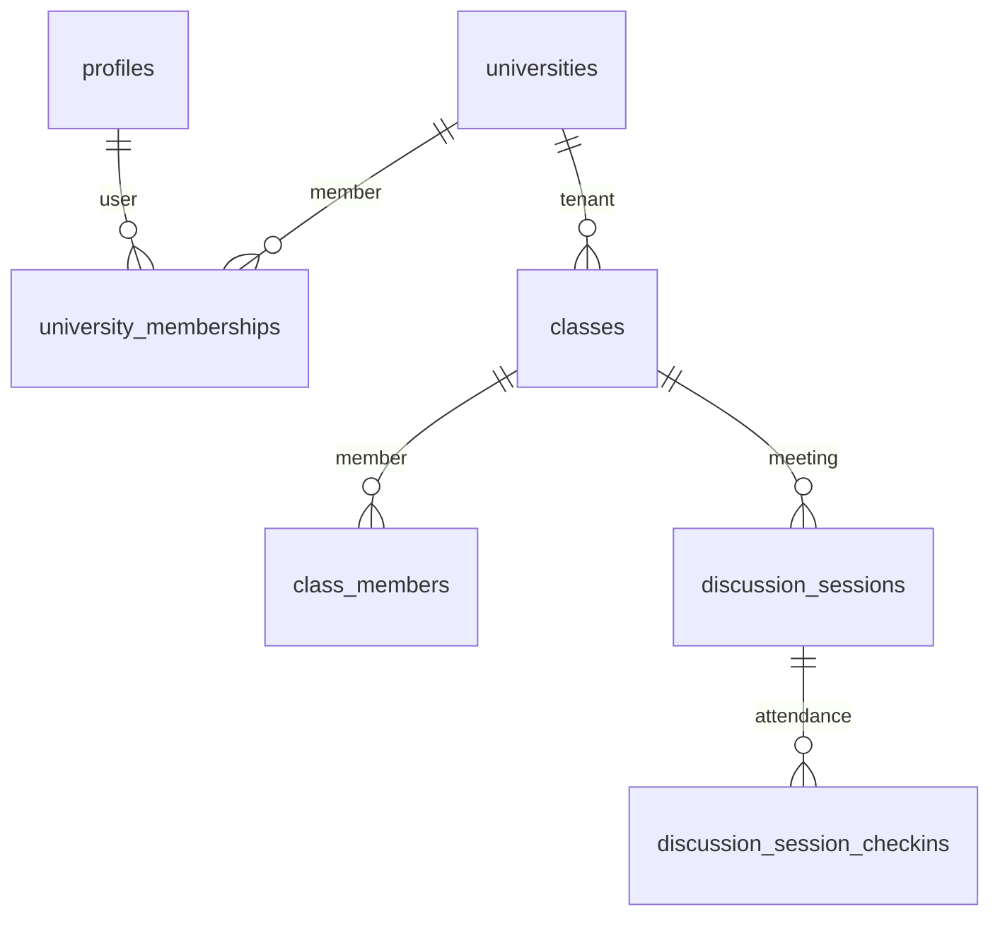

# Proposed Database Architecture (design only, not implemented)

## Tenant isolation contract

1. `universities` is the tenant root. `university_memberships` binds user↔tenant.
2. Every tenant-owned table carries `university_id NOT NULL`.
3. Unique constraints become `(university_id, …)`.
4. RLS adds `AND university_id = current_tenant()` — never replaces class check.
5. SECURITY DEFINER functions re-check tenant server-side; client-sent `university_id` ignored.
6. `platform_admins` stays global, gated by separate claim — never via tenant column.

## What does NOT change

- `courses` catalogue stays shared (read-only, write via `create_or_get_course`).
- Attendance/leave/assignment tables keep their class FKs; `university_id` is additive.
- Backup/restore flow unchanged (see `backup/RESTORE_RUNBOOK.md`).

Migration complexity: HIGH (83 policies + 143 functions + backfill). Gated on full logical backup VERIFIED.
